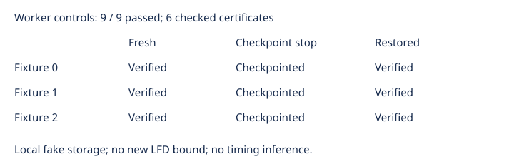

# Blocked producer worker integration controls

Observations only. The new blocked native binary is exercised through the unchanged actual worker. Restored publication counts are derived from archived acknowledgments. All nine actual local controls passed: fresh completion, deliberate checkpoint stop, and restored completion for each of three retained Semaev fixtures. The six completed exports match the retained certificate hashes, and the original independent checker accepts each. Fresh exact solution counts and accepted codimensions are 3, 1, and 1 for fixtures 0, 1, and 2. No inequality supporting LFD at least 6 occurs.

The three source controls intentionally stop after checkpoint publication; they are not completed certificates. Restored workers use the same request and verified source state, and complete the original checker and exact count again. Seed inputs are streamed from fixed gzip files through the URL transfer interface. Storage is local fake AWS; these controls do not establish cloud permissions or frontier memory/disk admission. The separate export-guard controls cover explicit refusals and corruption.

All 736 archived file sizes and hashes verify. Nine actual rows, one attempt each, no exclusions. Logs are bounded and timings are diagnostic only. Frozen source commit: 5428d7f6dc2860290604f0e493159a85130f6e92. Frozen protocol: a9c93753e54beee0e9095d74c20c39f178f4c5e64b5b6964e9da7906c0fbc7e7.

The running frontier worker is unchanged. These small controls are not frontier memory admission or a timing comparison. Forty original high-memory inputs and ten panel inputs remain unfinished. No new mathematical bound is claimed.
