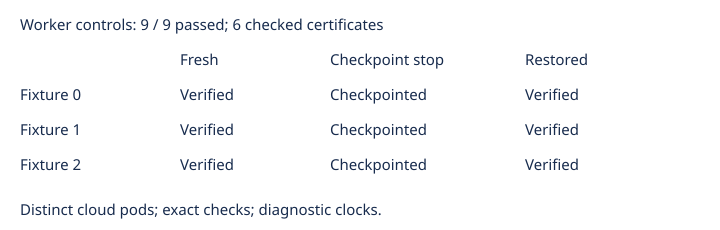

# Blocked checkpoint worker cloud controls

Observations only. All nine actual cloud controls passed: fresh completion, deliberate checkpoint stop, and restored completion for each of three retained Semaev fixtures. The six completed exports match the retained certificate hashes, and the original independent checker accepts each. Fresh exact solution counts and accepted codimensions are 3, 1, and 1 for fixtures 0, 1, and 2. The fixture counts equal their accepted codimensions.

The three source controls intentionally stop after checkpoint publication; they are not completed certificates. Restored workers use the same request and verified source state, and complete the original checker and exact count again. Seed inputs are streamed from fixed gzip files through the URL transfer interface. Storage is real S3 with conditional publication and full readback. Source and restore use distinct pods. These small controls do not establish frontier memory/disk admission. The separate export-guard controls cover explicit refusals and corruption. The first blocked cloud source attempt reached its scheduling deadline without executing controls; its terminal evidence remains preserved. Version 2 keeps the same fixtures, bundle, and resource limits.

Source pod: `bbe03960-0d90-4ef8-805f-4dcc6a21854e`. Restore pod: `f5b60284-7fc6-4621-9feb-4c251d1546a4`.

All 556 archived file sizes and hashes verify. Nine actual rows, one attempt each, no exclusions. Logs are bounded and timings are diagnostic only. Frozen source commit: 8a30fc3a6baf52ae6afbde0fbb58727d4aafa22e. Frozen protocol: e28a446779652f406e0e564c13f9b921c074ea5444389b3aeea32b8f9d741663.

Next: admit the retained n=47 frontier request using this qualified worker. The 40 unfinished high-memory inputs and eight unfinished panel inputs remain in scope. The next large-input run is n47 random02, using its retained D4 seed and fresh exact count.
