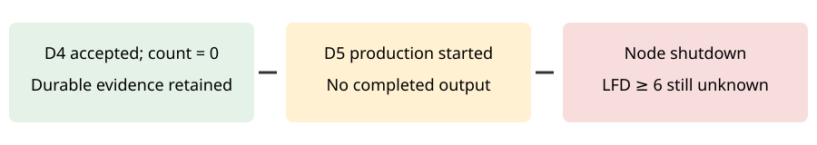

# Bounded lift attempt 002: node shutdown

The bounded degree-five continuation ended without a completed degree-five result. Kubernetes explicitly records imminent node shutdown at 05:07:22 UTC on 2026-10-30, DisruptionTarget/TerminationByKubelet, and exit code 137. The Job then reports BackoffLimitExceeded. This is an infrastructure interruption; an OOM diagnosis does not follow.

Job: semaev-n47-rand00-d5-durable-20261030-0255. Job UID: 5004ed65-7380-44ed-8894-52de6b37e9b1. Pod UID: dd63deda-6496-4295-a23f-b208ba92605e. Node: ip-10-84-9-154.us-east-2.compute.internal. The container started at 03:31:37 UTC. Allocation was 112 GiB and two CPUs, with a 96 GiB child cap, six-hour deadline, and zero automatic retries. Times are L0 operational observations, not performance evidence.

The 58 retained S3 objects preserve successful startup controls, the original independent check of the D4 seed (codimension at least 61,196), fresh exact solution count zero, and the produce5 start record uploaded at 03:59:48 UTC. They contain no produce5 completion, degree-five certificate, check5 result, or final result.json. Log retrieval returned NotFound. No stronger lower bound or upper bound follows from this attempt. The prior accepted LFD >= 5 bound remains intact.

Evidence: ../../runs/bounded-lift-terminal-002.json and ../../runs/bounded-lift-terminal-002.objects.json, committed in b07b447b22; ../../runs/bounded-lift-progress-003/ retains completed frontier prechecks. Exact request and command are in ../../runtime/bounded-lift-request-003.json and ../../runtime/bounded-lift-job-002.json. The frozen scope is ../../bounded-lift-protocol-002.json; worker manifests and startup controls remain immutable.

The one-attempt continuation is exhausted. Stage receipts preserved completed stages but cannot restore partially computed matrices. The next requirement is a qualified recovery mechanism or a suitable placement, followed by a separately frozen continuation. No replacement job has launched. The diagram adds an infrastructure interruption to the evidence chain; no canonical mathematical theorem graph changes.

