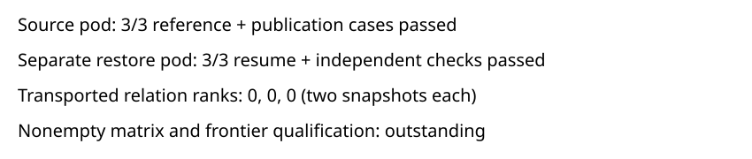

# Real cloud checkpoint recovery: attempt 002

Observations only. All six actual rows passed: three source/publication cases and three restore cases on a distinct pod. Frozen reference bytes, original independent checker codimensions, and fresh exact counts agree across roles. The pairs (codimension, solutions) are (3,3), (1,1), and (1,1). Equality establishes no new LFD lower bound.

All six transported checkpoints have relation rank zero and contain headers/footer only. This qualifies real storage publication, full readback, manifest selection and fresh-pod restart for these fixed fixtures. It does not qualify nonempty relation-matrix transport, frontier memory/storage admission, or degree-six bounds. A nonempty checkpoint control is required before frontier retry. The earlier failed attempt and its missing restore rows remain unchanged.

Source pod: `32733d26-c921-4b1d-82cf-432b69234160`. Restore pod: `73e251b2-cb7a-405b-8f16-f120de0b725b`.

All111 archived file hashes verified. Export validation: True. Protocol SHA: `5bda109bd162ce0fa41d24814ca878e4533722446238d90bd9cb8e4e3b509e71`.

No canonical mathematical graph changes.
