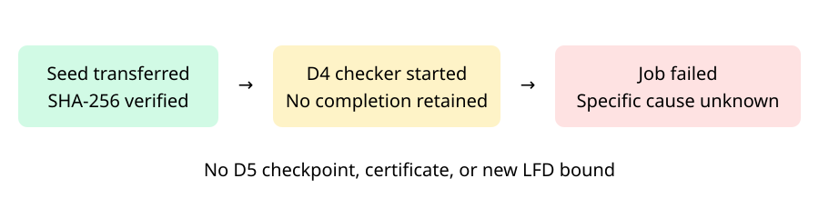

# Checkpoint-enabled frontier attempt 001

Observations only. The n47 random00 job failed at 15:35:27 UTC on 2026-10-30 with Kubernetes BackoffLimitExceeded. At collection time the pod was no longer retained and bounded log retrieval returned an empty string. The specific cause is unknown: neither OOM nor Spot interruption is established by this retained record.

Four durable stage records remain: environment and memory admission, startup disk admission, completed seed transfer, and the start of the original D4 checker. The full S3 prefix contains no checker completion, fresh count, D5 start, checkpoint manifest, certificate, or final worker result. Thus no degree-five state can be restored from this attempt and no new LFD bound follows.

Job UID: `2df3a8bf-e685-4dd0-866a-4ce34a067624`. Observed pod UID while live: `98a70edf-a534-4121-9d1b-7f599d12f131`. The seed transfer verified 1,632,838,224 bytes with SHA-256 `3bdad807113e43ec41ac6e9edcb2a282ffa486c7a694eba0dd3e0e9b0fa5162f`. Resource admission had succeeded. Terminal status and unavailable-log response are preserved in `runs/checkpoint-frontier-{terminal,logs}-001.json`; stage receipts remain in `validation/checkpoint-frontier-001/`.

The earlier bounded attempt's retained original-checker transcript independently accepted this identical seed and identical system with codimension at least 61,196. A prospective continuation can reuse that exact acceptance after verifying byte identity and the complete evidence binding; it must label the check historical, freshly enumerate the solutions, and still require original independent checking of any D5 certificate. Such reuse is not implemented or qualified by this failure report. No replacement job has launched. The separate local n44 panel worker remains in flight.

