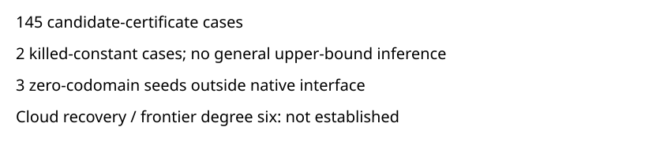

# Local checkpoint producer controls

Observations only. The frozen local suite completed 150 fixture descriptions and 1245 child steps: 145 candidate-certificate cases, 2 killed-constant cases, and 3 zero-codomain seed cases outside the native interface. The harness reported no failures and all ten coverage flags true. The three unsupported seeds are not native successes. These controls establish no cloud durability or frontier LFD bound.

The frozen four-arm protocol implies 600 export rows, but execution records composite fixtures with embedded reference and fault checks. The truthful 150-row export remains invalid; missing arm rows are not manufactured. This is a reporting/protocol gap, separate from the recorded software assertions. The new cloud protocol registers two actual execution roles prospectively. Full raw custody is retained through raw-artifacts.json; all 36,003 archive entries were checked against their sizes and SHA256 digests.

- closure_round_restore: True
- corrupt_rejected: True
- every_seed_boundary: True
- export_restore: True
- hook_failure_rejected: True
- killed_constant: True
- multiple_closure_rounds: True
- repeated_restore: True
- wrong_chunk_rejected: True
- wrong_seed_rejected: True

No canonical mathematical graph changes. Exact inputs and source identities are in plan.json and protocol.json; detailed cases remain in result.json.
