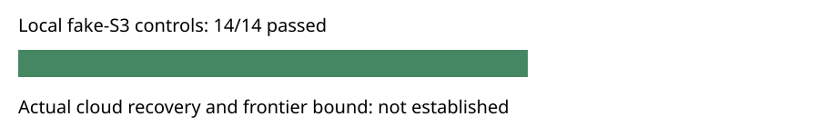

# Checkpoint transport controls

14 of 14 fixed local fake-S3 controls passed. The archive contains 283 hash-verified files. This is not actual cloud permission or durability evidence and establishes no LFD bound.

Export is incomplete: the frozen protocol declares separate arms but the harness recorded composite candidate cases. Missing arm rows are not fabricated. A prospective corrected-protocol replay is required for a valid export.

| Case | Passed | Child steps |
|---|---:|---:|
| object_put | True | 3 |
| object_get | True | 3 |
| object_corrupt_get | True | 3 |
| manifest_put | True | 3 |
| manifest_get | True | 3 |
| manifest_corrupt_get | True | 3 |
| wrong_snapshot_context | True | 1 |
| idempotent_publication | True | 2 |
| prune_after_readback | True | 2 |
| fallback_corrupt_object | True | 3 |
| fallback_corrupt_manifest | True | 3 |
| wrong_restore_context | True | 3 |
| truncated_listing | True | 3 |
| restore_newest_and_replay | True | 4 |

The workload uses a filesystem-only fake AWS executable. Controls cover interrupted PUT/GET, corruption, idempotence, verified pruning, fallback, context mismatch, incomplete listing, and native replay against retained reference certificate bytes. Child commands and their original stdout/stderr are in the evidence archive. Each child has a 1 GiB cap and 120-second watchdog; timings are L0 telemetry only. Inputs, code and native binary hashes are in plan.json. The source revision is pinned in protocol.json. Actual cloud publish, replacement-worker restore and independent certificate checking remain required. No canonical mathematical graph changes; this diagram records software-control status only.

