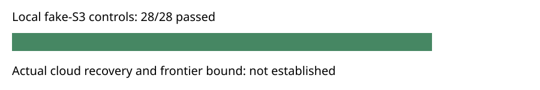

# Checkpoint transport controls

28 of 28 fixed local fake-S3 controls passed. The archive contains 553 hash-verified files. This is not actual cloud permission or durability evidence and establishes no LFD bound.

Export validation passed for the composite case rows.

| Configuration | Case | Passed | Child steps |
|---|---|---:|---:|
| retain | object_put | True | 3 |
| retain | object_get | True | 3 |
| retain | object_corrupt_get | True | 3 |
| retain | manifest_put | True | 3 |
| retain | manifest_get | True | 3 |
| retain | manifest_corrupt_get | True | 3 |
| retain | wrong_snapshot_context | True | 1 |
| retain | idempotent_publication | True | 2 |
| retain | prune_after_readback | True | 2 |
| retain | fallback_corrupt_object | True | 3 |
| retain | fallback_corrupt_manifest | True | 3 |
| retain | wrong_restore_context | True | 3 |
| retain | truncated_listing | True | 3 |
| retain | restore_newest_and_replay | True | 4 |
| prune | object_put | True | 3 |
| prune | object_get | True | 3 |
| prune | object_corrupt_get | True | 3 |
| prune | manifest_put | True | 3 |
| prune | manifest_get | True | 3 |
| prune | manifest_corrupt_get | True | 3 |
| prune | wrong_snapshot_context | True | 1 |
| prune | idempotent_publication | True | 2 |
| prune | prune_after_readback | True | 2 |
| prune | fallback_corrupt_object | True | 3 |
| prune | fallback_corrupt_manifest | True | 3 |
| prune | wrong_restore_context | True | 3 |
| prune | truncated_listing | True | 3 |
| prune | restore_newest_and_replay | True | 4 |

The workload uses a filesystem-only fake AWS executable. Controls cover interrupted PUT/GET, corruption, idempotence, verified pruning, fallback, context mismatch, incomplete listing, and native replay against retained reference certificate bytes. Child commands and their original stdout/stderr are in the evidence archive. Each child has a 1 GiB cap and 120-second watchdog; timings are L0 telemetry only. Inputs, code and native binary hashes are in plan.json. The source revision is pinned in protocol.json. Actual cloud publish, replacement-worker restore and independent certificate checking remain required. No canonical mathematical graph changes; this diagram records software-control status only.

