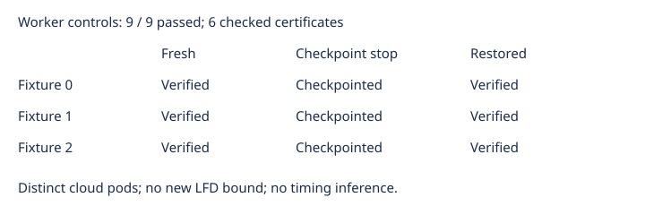

# Checkpoint-aware worker cloud controls

Observations only. All nine actual cloud controls passed: fresh completion, deliberate checkpoint stop, and restored completion for each of three retained Semaev fixtures. The six completed exports match the retained certificate hashes, and the original independent checker accepts each. Fresh exact solution counts and accepted codimensions are 3, 1, and 1 for fixtures 0, 1, and 2. No inequality supporting LFD at least 6 occurs.

The three source controls intentionally stop after checkpoint publication; they are not completed certificates. Restored workers use the same request and verified source state, and complete the original checker and exact count again. Seed inputs are streamed from fixed gzip files through the URL transfer interface. Storage is real S3 with conditional publication and full readback. Source and restore use distinct pods. These small controls do not establish frontier memory/disk admission. The separate export-guard controls cover explicit refusals and corruption. Earlier cloud attempt 001 failed before any trial because its results parent was absent; its original logs and failure report remain preserved.

Source pod: `4487b4ce-5054-4075-b312-e7a80005d53b`. Restore pod: `81e24558-6fd2-447a-b1fc-d9c12385ab85`.

All 556 archived file sizes and hashes verify. Nine actual rows, one attempt each, no exclusions. Logs are bounded and timings are diagnostic only. Frozen source commit: e29bc2ea67eff584b153064d7be47b7b699f3f0f. Frozen protocol: 1224bb2935ebb1594623c70aaa8c5f7766e91e7b3695faee18def28017978887.

Next: admit the retained n=47 frontier request using this qualified worker. The 40 unfinished high-memory inputs and 11 unfinished panel inputs remain in scope. No new mathematical bound is claimed.
