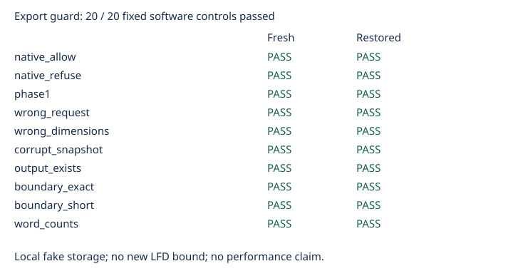

# Export admission guard controls

All 20 actual local software controls passed: ten fresh-path and ten restored-path cases. Allowed native exports match the frozen 1616-byte reference certificate. Fresh refusal publishes and verifies the phase-2 checkpoint before deferring export; restored refusal prevents native execution. The exact byte boundary allows export and one byte below refuses. Corrupt checkpoints, mismatched identities and existing output paths are rejected. Phase-1 handling and certificate word-count arithmetic also pass.

Storage is a local fake AWS service. The boundary arithmetic cases use the same direct prelaunch path in both configurations, as preregistered. This is not a large-file, cloud-worker or mathematical qualification. No new LFD lower bound follows. Frontier worker integration and end-to-end controls remain required before the next large run.

All 169 archived files were verified against their recorded sizes and SHA-256 hashes. Both configurations ran once with no retries; no outcomes were excluded. Timings are diagnostic only on a shared host.

