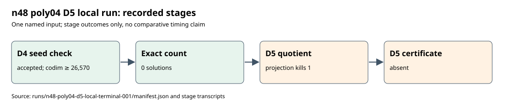

# n48 poly04 local degree-five attempt

The frozen n48 poly04 attempt completed its seed check, exact count and native degree-five producer. The original independent checker accepted the D4 seed with codimension at least **26,570**; fresh exhaustive counting found **0** solutions. The D5 quotient producer returned `projection_kills_one` with 42,791 working coordinates and relation rank 42,791. It wrote no D5 certificate, so this run supplies no LFD >= 6 bound or upper bound.

[Terminal evidence](../../runs/n48-poly04-d5-local-terminal-001/manifest.json) preserves 19 small raw artifacts with SHA-256 hashes, including the admission, stage receipts and native transcripts. The published D4 seed is pinned by SHA-256 `7b005b030abd84c98d3be2658dd06070d0b9cb177c28f8cd81e310b0cf74c47e`. The worker ran under the [frozen protocol](protocol.json), SHA-256 `49edc7d0db15afebf7e5703edf5099a352ae0de39b3973ebbdd760f02cd966e0`, with a 24 GiB child cap. Admission saw 32,636,637,184 available bytes. Recorded stage durations were 483.919 seconds for D4 check, 18.167 seconds for exact count and 971.336 seconds for the producer; all wall measurements are marked invalid for performance comparison on the shared host.

The command was `python analysis/semaev-degree-five-quotient-lift/launch_local_lift.py --plan analysis/semaev-degree-five-quotient-lift/n48-poly04-d5-local-plan-001.json --protocol analysis/semaev-degree-five-quotient-lift/n48-poly04-d5-local-protocol-002.json`. One named input was attempted; its two recorded arms (producer and exact count) completed, with no resume or timeout. The producer outcome is a quotient non-detection, so the next technical step is a different accepted D4 seed or an exact D5 construction.

