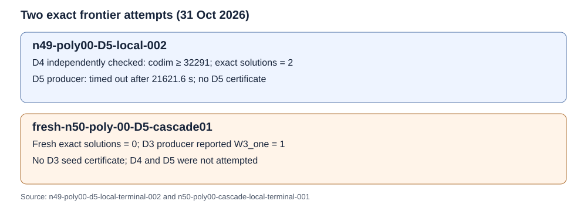

# n49 and n50 frontier terminal records

The n49 poly00 retained-seed attempt preserved an independently accepted degree-four certificate with codimension at least 32,291 and a fresh exact count of two solutions. Its degree-five producer reached the frozen 21,600-second watchdog after 21,621.6 seconds recorded by the wrapper, with nine durable checkpoints and no degree-five certificate. The last checkpoint is still in the seed-relation phase at variable 1, row 240,000; its native relation rank is 59,351 in 59,353 working coordinates. That checkpoint is operational state, not independent mathematical acceptance.

The next original frontier input, n50 poly00, had zero solutions in a fresh exhaustive count. Its degree-three producer reported `W3_one 1` and wrote no seed certificate. The frozen cascade stopped there, so degree four and degree five were not attempted. No LFD ≥ 6 claim follows from either terminal record.

The n49 run is `n49-poly00-D5-local-002`, under protocol `SEMAEV-N49-POLY00-D5-LOCAL-20261031-V2`; its archived terminal record is `runs/n49-poly00-d5-local-terminal-002/manifest.json`. The seed certificate is retained separately with SHA-256 `b4f6043cbc48c34a6cbaeca802b0d5cfa222394456ac72ca9c0bb9873a3370d5`. The n50 run is `fresh-n50-poly-00-D5-cascade01`, under protocol `SEMAEV-N50-POLY00-CASCADE-LOCAL-20261031-V1`; its terminal record is `runs/n50-poly00-cascade-local-terminal-001/manifest.json`. Both archived manifests hash every copied artifact; the n50 gate also read back the last n49 S3 checkpoint manifest before launch.

The n49 producer status is a timeout, not a computed closure result. The n50 producer status is `seed_without_certificate`, backed by the recorded `W3_one 1` transcript. Two named inputs were attempted: one timed out at degree five, one stopped at degree three. The recorded counts are exact for their named inputs; no population rate or timing comparison is inferred. The n49 wrapper marks wall timing invalid, and neither run recorded comparable CPU time. The host was the same local shared machine; n50 admission sampled 36,889,767,936 available bytes against a 19,327,352,832-byte requirement.

The next data step is the following original n50 frontier input, poly01, with a separately frozen named-input protocol and fresh admission. The original 50-input plan remains unchanged.
