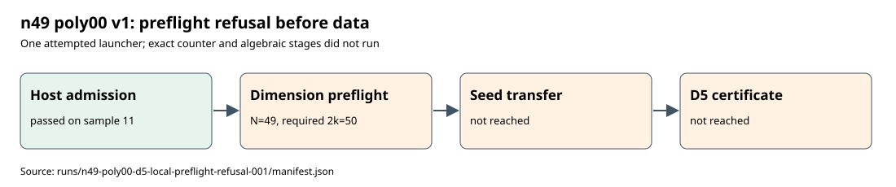

# n49 poly00 v1 local preflight refusal

The first frozen n49 poly00 local attempt passed host admission on sample 11 after 110.266 seconds, with 37,462,147,072 available bytes against a 32 GiB child cap plus a 2 GiB reserve. The worker then raised `seed size disagrees with frozen dimensions` before seed transfer. Its disk policy set `N=49` from the curve parameter; the published D4 certificate has **50 Boolean variables** (`2k` for `k=25`). No independent seed check, fresh count, D5 producer, or certificate ran in this attempt.

The [raw refusal record](../../runs/n49-poly00-d5-local-preflight-refusal-001/manifest.json) pins the admission, terminal and stderr artifacts. The [frozen v1 protocol](protocol.json) remains unchanged. The separate corrected [v2 protocol](../../n49-poly00-d5-local-protocol-002.json) uses `disk_policy.N=50`, a new output root and a new checkpoint prefix. The launcher now checks the variable count and seed-size formula before memory admission, with a regression test.

The export records two planned protocol cells: the producer cell failed at preflight and the exact-count cell was cancelled before its executable was invoked. Only one launcher invocation occurred. The native D5 stage was not reached, so this refusal provides no last-fall-degree conclusion.

