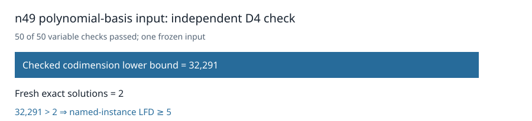

# Certified n49 polynomial-basis input: LFD at least five

The original independent checker accepted the retained D4 certificate for `fresh-n49-poly-00`. It checked all 50 variable multiplications and established `1 ∉ W_4(F)` with codimension at least **32,291**. A fresh exhaustive count returned **2** solutions. The strict inequality certifies **last fall degree ≥ 5** for this named Boolean presentation.

The certificate was produced during the earlier frozen frontier cascade and retained when that run was interrupted. Its SHA-256 is `b4f6043cbc48c34a6cbaeca802b0d5cfa222394456ac72ca9c0bb9873a3370d5`. The later [independent recheck](../../validation/n49-poly00-retained-check-001/result.json) first matched the certificate, input-system, original-plan, and recovery-plan hashes, then ran the original checker and pinned exact counter. The checker took 737.422 seconds and the counter took 17.990 seconds. These are execution records for this input.

The [public readback receipt](../../n49-retained-archive-001/fresh-n49-poly-00-D4-retained01.publication.json) verifies anonymous download, gzip decompression to the retained certificate hash, and canonical object-store readback. [Download the certificate](https://github.com/isogeny-labs/crypto-autoresearcher/releases/download/semaev-closure-certificates-20261029/fresh-n49-poly-00-D4-retained01.D4.cert.gz). The degree-five stage for this input has not been certified, so its LFD-six status remains unknown.

The original source plan SHA-256 is `cc503cf2523b8b202476e03aeb493ad4f8a2e85500e825f75067b3baf855c4b7` and the frozen recovery protocol SHA-256 is `73dad26981fed6a8e21edccc70851b63183820f789283c65a07308ec2633124e`. The [verification script](verify_retained_n49_poly00.py) records the exact checker and counter commands and their return codes.

