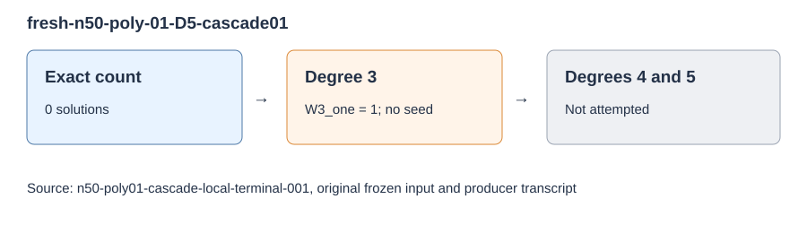

# n50 poly01 cascade terminal record

The next original n50 input, `fresh-n50-poly-01-D5-cascade01`, had zero solutions in a fresh exhaustive count. Its degree-three producer recorded `M3_one 1` and `W3_one 1`, wrote no seed certificate, and the frozen cascade stopped. Degrees four and five were not attempted on this named input, so this run supplies no new LFD lower bound.

The fixed input came from the original 50-item `cascade-plan.json`, under `SEMAEV-N50-POLY01-CASCADE-LOCAL-20261031-V1`. The one-attempt terminal record, count transcript, degree-three transcript, pinned-source launch gate and file hashes are in `runs/n50-poly01-cascade-local-terminal-001/`. The launch gate sampled 37,482,303,488 available bytes against the 19,327,352,832-byte requirement and held both campaign locks. The producer ran with one thread, 16 GiB cap, 60,000-row chunks and a 21,600-second command watchdog; no comparable timing metric was collected.

This was one exact named-input result, with no population inference. Its next step was the separately frozen continuation of the remaining original n50/n51 frontier inputs, reported in `reports/n50n51-cascade-local-001/`.
