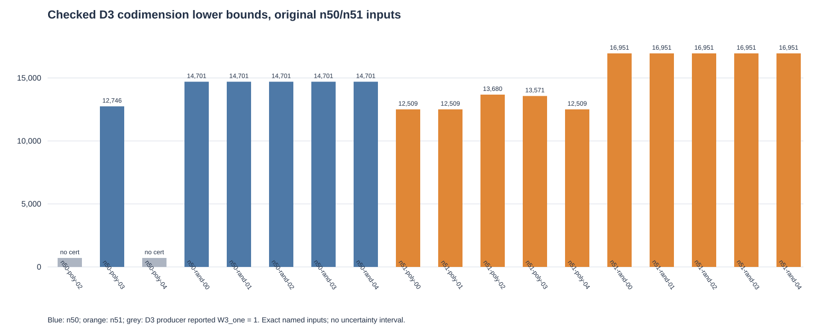

# Original n50/n51 frontier cascade panel

The frozen 18-input continuation completed all 18 original n50/n51 records that remained after poly00 and poly01. Six n50 inputs and all ten n51 inputs produced independently checked degree-three certificates. In every one of those 16 named presentations, the checked codimension lower bound exceeded the fresh exhaustive solution count, establishing LFD ≥ 4. The other two n50 inputs reported `W3_one 1` and produced no certificate. The original 50-input frontier plan, including its n47–49 rows, remains unchanged.

Every attempted degree-four lift returned `lift allocation gate refused` under the pinned 16 GiB native limit. No D4 or D5 certificate was produced by this panel. The statuses are 16 `resource_capped` and two `seed_without_certificate`; the raw results, exact counts, native stderr and independent checker transcripts are retained under `runs/n50n51-cascade-local-terminal-001/`. The 16 accepted D3 seed binaries are published as compressed assets in the `semaev-frontier-d3-seeds-20261031` release. Its manifest records both compressed and decompressed SHA-256 hashes; all 16 assets were downloaded, decompressed and rehashed after publication.

The producer was the pinned `run_cascade.py` cascade with `count_by_sum`, dense `lfdclose2` D3 seed construction, the original `cert_check.py`, and the original native quotient lift. It ran sequentially on the shared local host, one thread, 16 GiB per native child and 60,000-row chunks. The frozen per-command watchdog was 21,600 seconds. This report makes no timing comparison: the command records mark wall timing invalid and do not contain comparable CPU times. Exact solution counts and checked codimensions are per named input in `rows.json`, without a population estimate.

Read-only profiles of all 16 retained D3 seeds independently agreed on their border-coordinate counts and calculated a bounded checkpoint D4 allocation envelope between 13,207,168,721 and 28,263,000,132 bytes. Those values are source-derived admission arithmetic, not measured RSS or a D4 result. The next frozen continuation will recheck every seed and fresh count, then attempt D4 under a 27 GiB cap with the bounded producer.
