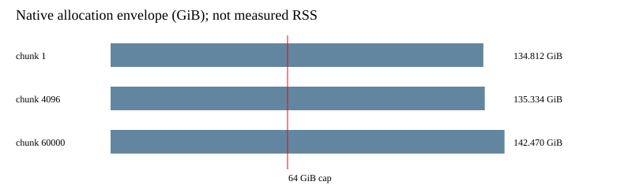

# n47 random00 degree-five allocation envelope

The accepted D4 seed yields 126,387 border coordinates under both enumeration directions and 187,583 working coordinates. Certificate SHA256: `3bdad807113e43ec41ac6e9edcb2a282ffa486c7a694eba0dd3e0e9b0fa5162f`.

| Chunk rows | Native envelope bytes | GiB |
|---:|---:|---:|
| 1 | 144752755295 | 134.812 |
| 4096 | 145314027461 | 135.334 |
| 60000 | 152976386232 | 142.470 |

The 64 GiB refusal is reproduced by the exact source formula. Even chunk=1 exceeds this host total memory (132,915,916,800 bytes observed before the profile). Smaller batches alone cannot admit this representation here. The formula reserves map/export copies and a 35% margin; these are not measured peak RSS or a minimum-memory theorem. No closure was run and no new LFD bound follows.

Next: qualify a larger-limit instrument on a suitably provisioned host, or reduce the representation. Keep the active campaign unchanged. The desired degree-five certificate still must pass the original independent checker with codimension strictly greater than exact solution count zero.

Method: frozen [protocol](../../native-envelope-protocol-001.json), SHA-bound [plan](../../native-envelope-plan-001.json), [raw calculation](raw/result.json), and exact native formula in `quotient_lift_batched.cpp`. Source review is internal; no external novelty claim. Controls: full and empty borders for N=3..7, literal allocation arithmetic fixture, source/input digest checks, triangularity and independent border enumeration. Shared-host timing is invalid.

