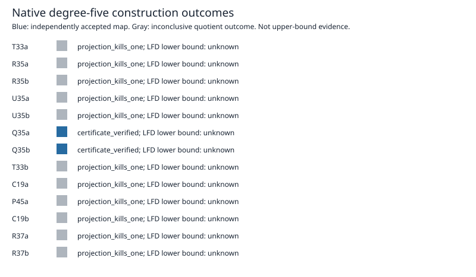

# Native degree-five historical lift batch

All thirteen frozen historical inputs were attempted. A certificate is accepted only after the original independent checker; LFD >= 6 additionally requires the exact solution count to be strictly smaller than its checked codimension.

| Seed | Outcome | Exact solutions | Checked codimension | LFD lower bound from D5 |
|---|---|---:|---:|---:|
| T33a | projection_kills_one | 0 | unknown | unknown |
| R35a | projection_kills_one | 0 | unknown | unknown |
| R35b | projection_kills_one | 0 | unknown | unknown |
| U35a | projection_kills_one | 0 | unknown | unknown |
| U35b | projection_kills_one | 0 | unknown | unknown |
| Q35a | certificate_verified | 6 | 6 | unknown |
| Q35b | certificate_verified | 2 | 2 | unknown |
| T33b | projection_kills_one | 0 | unknown | unknown |
| C19a | projection_kills_one | 0 | unknown | unknown |
| P45a | projection_kills_one | 0 | unknown | unknown |
| C19b | projection_kills_one | 0 | unknown | unknown |
| R37a | projection_kills_one | 0 | unknown | unknown |
| R37b | projection_kills_one | 0 | unknown | unknown |

`projection_kills_one` means the constructed quotient kills the constant. Its seed kernel is only independently known to contain W4, so this outcome is not a proved refutation in W5 and does not establish an upper bound. A certificate with codimension equal to the solution count gives no degree-six lower bound.

The first owner stopped after T33a because an upstream merge reapplied sparse patterns. The new directory was added permanently, frozen hashes were verified, and the terminated owner was confirmed. The resumed runner reused T33a and processed the remaining inputs. No completed elimination was rerun.

Sources: raw records, public certificate acknowledgements, summary.json, export.json and ../../lift-protocol.json. Original trace output is retained. The n47..51 frontier panel remains a separate unfinished requirement.

