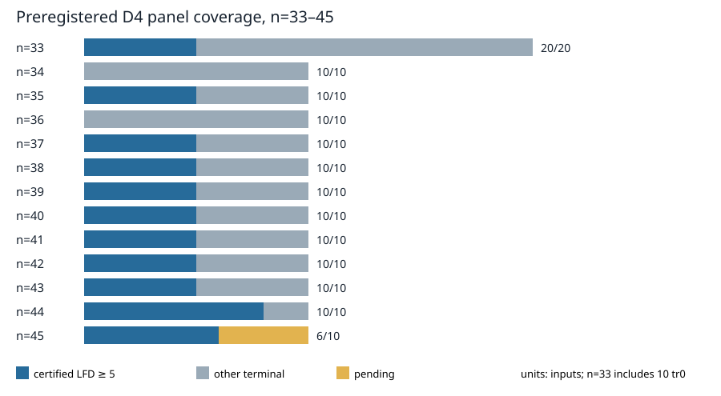

# D4 panel coverage through n=45

The preregistered plan has **140** named D4 inputs at n=33–45: ten per n, plus ten trace-zero inputs at n=33. The [coverage audit](../../validation/panel-coverage-20261031-001/coverage.json) matched **136 terminal records** to distinct planned IDs and checked their result and inference links. **59** records carry an LFD ≥ 5 lower bound; **77** other terminal records do not establish that lower bound. The four pending IDs are `fresh-n45-rand-01` through `fresh-n45-rand-04`. Random-01 is running, so it remains pending in this immutable snapshot.

| n | Planned | Terminal | Certified LFD ≥ 5 | Other terminal | Pending |
|---:|---:|---:|---:|---:|---:|
| 33 | 20 | 20 | 5 | 15 | 0 |
| 34 | 10 | 10 | 0 | 10 | 0 |
| 35 | 10 | 10 | 5 | 5 | 0 |
| 36 | 10 | 10 | 0 | 10 | 0 |
| 37 | 10 | 10 | 5 | 5 | 0 |
| 38 | 10 | 10 | 5 | 5 | 0 |
| 39 | 10 | 10 | 5 | 5 | 0 |
| 40 | 10 | 10 | 5 | 5 | 0 |
| 41 | 10 | 10 | 5 | 5 | 0 |
| 42 | 10 | 10 | 5 | 5 | 0 |
| 43 | 10 | 10 | 5 | 5 | 0 |
| 44 | 10 | 10 | 8 | 2 | 0 |
| 45 | 10 | 6 | 6 | 0 | 4 |

The audit checks plan and inventory hashes, result identity, count and inference-chain arithmetic for the earlier expansion, and result hashes and strict count-versus-codimension inequalities for the later panel. It does **not** rehash or replay every large certificate. A terminal `producer_contains_one` or a checked codimension equal to the solution count stays in “other terminal”; neither yields an upper bound on LFD. This is a point-in-time coverage report, not a statistical estimate of the probability of a bound.
