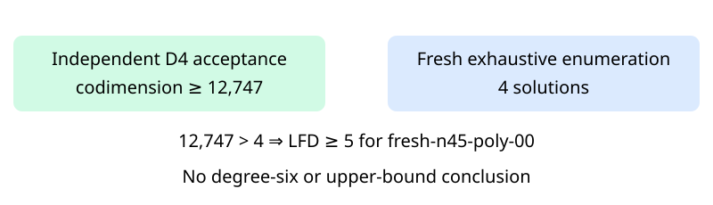

# Certified D4 panel input: n45 polynomial00

Observations only. The original independent checker accepted the newly produced degree-four certificate for fresh-n45-poly-00. All 46 multiplication-closure checks passed. Accepted codimension is **12,747** and fresh exhaustive Boolean solution count is **4**. Their strict inequality establishes **LFD>=5** for this exact named presentation. It establishes neither LFD>=6 nor an upper bound.

The certificate contains 288,550,808 bytes and has SHA-256 `e2ee2efe28ed90832632256794bceb2f8f473e82504d6e3bad2c1aa4be013dc1`. All 47 worker-recorded artifact hashes and the exact frozen request identity were verified after the worker and wrapper exited 0. Controls, counter, producer and checker each completed without timeout. The producer's 2771.406366586685 seconds and checker's elapsed time in result.json are shared-host L0 diagnostics, not performance comparisons.

This is one original unfinished input, not an additional random draw. The original 32-input panel now has 23 terminal inputs, including 16 certified LFD>=5 results; nine n45 inputs remain unfinished. The separate 40-input high-memory recovery scope remains unchanged. The n47 random00 D5 cloud computation is separate and has no accepted D5 output at this report snapshot.

The raw archive contains all non-certificate records, including controls and host information. The full certificate is retained at /home/ec2-user/fall-degree-data-20261029/panel-local-n45-poly00-001/attempt-001/certificate.bin. Public certificate publication and fresh download verification are recorded separately in panel-local-archive-001; this report does not anticipate publication success.

Frozen source commit: c863dad4f159ce9e29a8043e89f048ae26ff4a98. Frozen protocol: c3a86e3896b55859e04fc0569e9904a4e2404ebd0a9bf82b9b49c8f47f5b2124. Two actual stages are exported: producer with checker acceptance, and fresh exact count; they refer to one fixed input. No population-frequency or timing inference is made. The diagram records the new named-instance evidence, not a change to the general bound theorem.

Protocol prose discrepancy: the frozen variable ledger retains stale references to n44 random04 and earlier n43 scheduling. Its request path, prior input id, system digest, plan digest and observed checker arguments bind n45 polynomial00. The certificate claim uses those exact bytes and independent checking. The historical protocol is unchanged; full prose consistency is not claimed.
