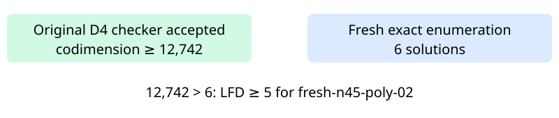

# Certified n45 polynomial02: LFD at least five

The original independent checker accepted the degree-four certificate for fresh-n45-poly-02. All 46 variable multiplication checks passed. The accepted codimension lower bound is 12,742; fresh exhaustive Boolean enumeration found 6 solutions. The strict inequality proves LFD at least five for this exact input presentation.

The certificate contains 288,550,808 bytes with SHA-256 dd768c4b4e95a09e1b1bf36771c1f2c34ab15fea0676e25fa89952fc8c6237c7. All 47 worker-recorded artifact hashes and the hash-pinned request identity were verified after successful terminal return. The controls, counter, producer and checker completed without timeout. The raw archive retains the small control certificates and all closed records except the separately retained main certificate.

Three earlier immediate admission attempts were refused before starting a worker. This separately frozen local04 attempt waited 91.28 seconds, preserving all ten admission samples, then passed the unchanged 40 GiB child cap plus 2 GiB reserve. Both campaign locks were held. Timings describe shared-host execution and are diagnostic.

The original 32-input panel now has 25 terminal inputs and 18 certified LFD-at-least-five results; 7 original inputs remain. This completes an existing input, with no replacement draw. The separate n47 random02 degree-five cloud run is in progress.

Full certificate: /home/ec2-user/fall-degree-data-20261029/panel-local-n45-poly02-004/attempt-001/certificate.bin. Public hosting and full-readback receipts are recorded separately in panel-local-archive-001.

Frozen source: eb3b399e9138074bd6570a1ab17ead3166518832. Frozen protocol: 39cb0cc78b86969787e171e65ac703f2c1081faae12df344b7d7ba412d5d3146. Its analysis-input paths and hash-pinned plan identify local04. The accompanying two-row export records producer/checker and exact-count stages on this one input.

