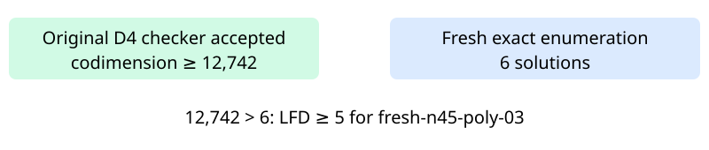

# Certified n45 polynomial03: LFD at least five

The original independent checker accepted the degree-four certificate for fresh-n45-poly-03. All 46 variable multiplication checks passed. The accepted codimension lower bound is 12,742; fresh exhaustive Boolean enumeration found 6 solutions. The strict inequality proves LFD at least five for this exact input presentation.

The certificate contains 288,550,808 bytes with SHA-256 2b4da41bafa129d7c098779e764b2f356a83bca6a8d2e61e021130a168315550. All 47 worker-recorded artifact hashes and the hash-pinned request identity were verified after successful terminal return. The controls, counter, producer and checker completed without timeout. The raw archive retains the small control certificates and all closed records except the separately retained main certificate.

This is the first scientific panel use of the separately qualified RREF exporter. Its 14 prior qualification rows passed; all three per-worker controls reproduced the reference certificate bytes and exhaustive counts. Admission passed on the first sample with 48,285,126,656 bytes available against the 40 GiB child cap plus 2 GiB reserve. Both campaign locks were held. The original independent checker remains the acceptance gate. No runtime comparison is claimed.

The original 32-input panel now has 26 terminal inputs and 19 certified LFD-at-least-five results; 6 original inputs remain. This completes an existing input, with no replacement draw. The separate n47 random02 degree-five cloud run is in progress.

Full certificate: /home/ec2-user/fall-degree-data-20261029/panel-local-n45-poly03-001/attempt-001/certificate.bin. Public hosting and full-readback receipts are recorded separately in panel-local-archive-001.

Frozen source: 204c10ee59ddfc3b3665902bdaf59f6b3673a5d5. Frozen protocol: 25066c60e9c7725a05a2c5829f37ac18ab6decbf3b5462b1de9c8b42e04370ef. Its analysis-input paths and hash-pinned plan identify the RREF local01 attempt. The accompanying two-row export records producer/checker and exact-count stages on this one input.

