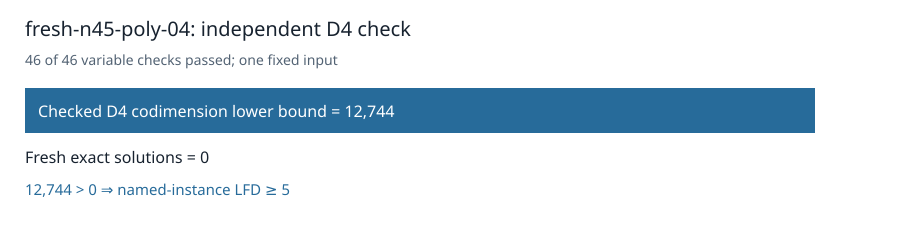

# Certified n45 polynomial04: LFD at least five

The original independent checker accepted the D4 certificate for the unchanged `fresh-n45-poly-04` input. All 46 variable-multiplication checks passed; it verified `1 ∉ W_4(F)` and codimension at least **12,744**. Fresh exhaustive enumeration found **zero** Boolean solutions. The strict inequality establishes **LFD ≥ 5** for this named presentation.

The certificate is **288,550,808 bytes**, SHA-256 `dc87ce3fe229236b0fe0aa9505208fde8f59212121009069ed2e6e8cc86cc98f`. The [collector](../../validation/panel-local-n45-poly04-final-001/manifest.json) verified all 47 worker artifacts, the frozen request and protocol, and successful terminal return. Three per-worker controls passed byte-identity, exact-count, and independent-checker tests. Producer, counter, controls, and checker completed without timeout. The collector's raw archive preserves all noncertificate records; the full certificate remains at `/home/ec2-user/fall-degree-data-20261029/panel-local-n45-poly04-001/attempt-001/certificate.bin` pending separate publication.

Admission passed on sample 53 after 535.495 seconds with **45,312,360,448 bytes** available against the unchanged 40 GiB child cap plus 2 GiB reserve. The producer took 3,088.882 seconds and the checker 208.650 seconds on a shared L0 host; these are execution records, not a runtime comparison.

The original 32-input D4 panel now has **27 terminal inputs**, **20 certified LFD≥5 inputs**, and **five remaining original n45 random-subspace inputs**. No new target or subspace was drawn. The next original input, n45 random00, has a frozen request and protocol and is admitted only after this terminal record, campaign-lock acquisition, and the checkpoint gate.

Frozen source commit: `fe215d2f392fe42d85eacdbfd83c845bb89ee38e`; frozen protocol hash: `505d717654959efa30b04ead5aca0e66173e4d96ca164e1e08596725eb675169`.

