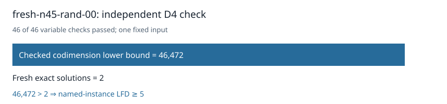

# Certified n45 random00: LFD at least five

The original independent checker accepted the D4 certificate for the unchanged `fresh-n45-rand-00` Boolean presentation. All 46 variable multiplication checks passed. It proved `1 ∉ W_4(F)` with codimension at least **46,472**. Fresh exhaustive enumeration found **2** solutions, so the strict inequality certifies **last fall degree ≥ 5** for this named instance.

The certificate is **1,045,099,360 bytes**, SHA-256 `01abd5f6072faecb3d91e62b64e9252125b3a0a3b7ee28c350805fe445ffe02f`. The [terminal collector](../../validation/panel-local-n45-rand00-final-001/manifest.json) checked all 47 worker artifacts, the frozen request and protocol, and successful return. Three per-worker controls passed. The certificate and evidence have [public readback receipts](../../panel-local-archive-001/fresh-n45-rand-00-rref-local01.publication.json); [download the certificate](https://github.com/isogeny-labs/crypto-autoresearcher/releases/download/semaev-closure-certificates-20261029/fresh-n45-rand-00-rref-local01.D4.cert.gz).

Admission passed on sample 7 after 70.499 seconds with 45,493,157,888 bytes available against a 40 GiB child cap plus 2 GiB reserve. Producer and checker took 2099.692 and 496.435 seconds on a shared host. These are execution records for this input.

The original 32-input D4 panel now has **28 terminal inputs**, **21 certified lower bounds of at least 5**, and **four remaining original n45 random-subspace inputs**. No new input was drawn. The separate n47 random02 D5 search is running from a verified checkpoint; it has no degree-five certificate yet.

The frozen input uses n=45, k=23, seed 6295638813592517003, and degree 4. The command was `python3 analysis/semaev-degree-five-quotient-lift/launch_local_panel.py --plan analysis/semaev-degree-five-quotient-lift/panel-local-n45-rand00-plan-001.json --protocol analysis/semaev-degree-five-quotient-lift/panel-local-n45-rand00-protocol-001.json`; the plan pins the runtime Python and worker paths. CPU time was not recorded.

Frozen source commit: `608be655740605d96d97157006c29894332a72db`. Frozen protocol SHA-256: `39569a234a66ef4997903c886b4cf6ac4ba0c8a409f85d81488c869c2a36b95a`.

