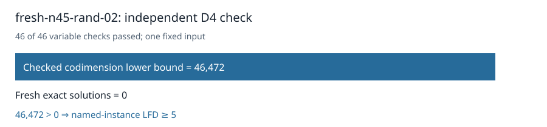

# Certified n45 random02: LFD at least five

The original independent checker accepted the D4 certificate for the unchanged `fresh-n45-rand-02` Boolean presentation. All 46 variable multiplication checks passed. It proved `1 ∉ W_4(F)` with codimension at least **46,472**. Fresh exhaustive enumeration found **0** solutions, so the strict inequality certifies **last fall degree ≥ 5** for this named instance.

The certificate is **1,045,099,360 bytes**, SHA-256 `e3ec47c17f44e25dc541b4dd6abebe2fa342bb1d186d0499e3763e5c3d2ea616`. The [terminal collector](../../validation/panel-local-n45-rand02-final-001/manifest.json) checked all 47 worker artifacts, the frozen request and protocol, and successful return. Three per-worker controls passed. The certificate and evidence have [public readback receipts](../../panel-local-archive-001/fresh-n45-rand-02-rref-local01.publication.json); [download the certificate](https://github.com/isogeny-labs/crypto-autoresearcher/releases/download/semaev-closure-certificates-20261029/fresh-n45-rand-02-rref-local01.D4.cert.gz).

Admission passed on sample 5 after 50.114 seconds with 48,864,034,816 bytes available against a 40 GiB child cap plus 2 GiB reserve. Producer and checker took 1987.561 and 480.203 seconds on a shared host. These are execution records for this input.

The original 32-input D4 panel now has **30 terminal inputs**, **23 certified lower bounds of at least 5**, and **two remaining original n45 random-subspace inputs**. No new input was drawn. The separate n47 random02 D5 restore attempt terminated without a new checkpoint or degree-five certificate; its stage remains unknown.

The frozen input uses n=45, k=23, seed 12558114396312731448, and degree 4. The command was `python3 analysis/semaev-degree-five-quotient-lift/launch_local_panel.py --plan analysis/semaev-degree-five-quotient-lift/panel-local-n45-rand02-plan-001.json --protocol analysis/semaev-degree-five-quotient-lift/panel-local-n45-rand02-protocol-001.json`; the plan pins the runtime Python and worker paths. CPU time was not recorded.

Frozen source commit: `608be655740605d96d97157006c29894332a72db`. Frozen protocol SHA-256: `5936dd6d08dded341aac3de83a3f88766b6c2535185fcad5cf9ca720dbce4c73`.

