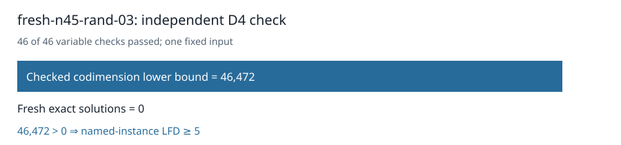

# Certified n45 random03: LFD at least five

The original independent checker accepted the D4 certificate for the unchanged `fresh-n45-rand-03` Boolean presentation. All 46 variable multiplication checks passed. It proved `1 ∉ W_4(F)` with codimension at least **46,472**. Fresh exhaustive enumeration found **0** solutions, so the strict inequality certifies **last fall degree ≥ 5** for this named instance.

The certificate is **1,045,099,360 bytes**, SHA-256 `3e023fd028e1e301aabaf1723ac2f1d084b07949bafd4c05a9f74c5dfaac7188`. The [terminal collector](../../validation/panel-local-n45-rand03-lowmem-final-001/manifest.json) checked all 47 worker artifacts, the frozen request and protocol, and successful return. Three per-worker controls passed. The certificate and evidence have [public readback receipts](../../panel-local-archive-001/fresh-n45-rand-03-rref-lowmem01.publication.json); [download the certificate](https://github.com/isogeny-labs/crypto-autoresearcher/releases/download/semaev-closure-certificates-20261029/fresh-n45-rand-03-rref-lowmem01.D4.cert.gz).

Admission passed on sample 0 after 0.008 seconds with 29,541,203,968 bytes available against a 24 GiB child cap plus 2 GiB reserve. Producer and checker took 2256.234 and 491.859 seconds on a shared host. These are execution records for this input.

The original 32-input D4 panel now has **31 terminal inputs**, **24 certified lower bounds of at least 5**, and **one remaining original n45 random-subspace input**. No new input was drawn. The separate n47 random03 D5 cloud Job failed without a degree-five certificate; the n48 poly04 local D5 attempt is frozen and queued after this terminal panel result.

The frozen input uses n=45, k=23, seed 13651200446574642926, and degree 4. The command was `python3 analysis/semaev-degree-five-quotient-lift/launch_local_panel.py --plan analysis/semaev-degree-five-quotient-lift/panel-local-n45-rand03-lowmem-plan-002.json --protocol analysis/semaev-degree-five-quotient-lift/panel-local-n45-rand03-lowmem-protocol-002.json`; the plan pins the runtime Python and worker paths. CPU time was not recorded.

Frozen source commit: `a4cc5210cce0e83bbd8faf54b6186a97c31241c5`. Frozen protocol SHA-256: `a24072c1a350f428727d979b13fd9e9f24db2a31b1daf7787bcfe12a61cff8f8`.

