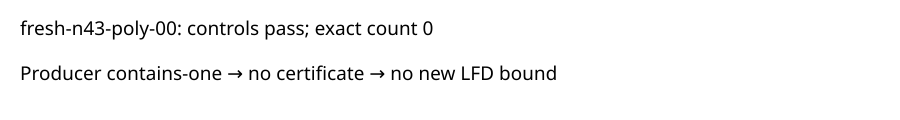

# Completed n43 polynomial-basis input 00

Observation only. The original input fresh-n43-poly-00 completed its portable retry. All 42 artifact hashes and original request bytes were verified. The fresh exact solution count is 0. The degree-four producer reports contains-one and emits no certificate. This is a producer observation, not an independently certified upper bound or a new lower bound. The prior interrupted attempt is preserved; the retry is not an extra sample.

Four of the 32 continuation inputs are now terminal: two n42 inputs certify LFD at least 5, n43 input 01 has accepted codimension 4 equal to count 4, and this input has no accepted certificate. Twenty-eight inputs remain unfinished. No degree-six result or population claim follows. Shared-host timing is telemetry only. Raw paths and verification count are in readback.json; the frozen single-input retry protocol is ../../panel-poly00-retry-protocol.json.

Job semaev-panel-n43-poly00-retry-20261029-1653 completed at 2026-10-29T17:20:08Z. The figure is an evidence-flow diagram because this report contains one outcome.

