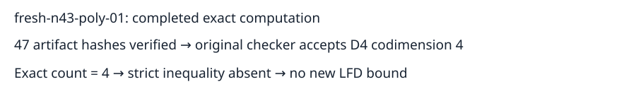

# Completed n43 polynomial-basis input 01

Observation: the original independent checker accepts a degree-four certificate of codimension4, equal to the freshly enumerated exact solution count4. The strict inequality required for the lower-bound criterion is absent. No new LFD lower bound or upper bound is inferred.

All47 artifact hashes were checked after downloading the completed remote result. Original request bytes match the fixed input archive. Full raw data, including the2399808-byte certificate, is publicly archived; publication.json records a fresh anonymous GET, archive hash, and extracted certificate hash. Local raw data and S3 prefix are in readback.json. Checker, count, producer and node-environment records are retained here.

This is the third completed input of the32-input continuation: two n42 inputs certify LFD>=5, and this n43 input has equal count/codimension. Twenty-nine remain unfinished. The failed earlier attempt remains preserved and is not an additional sample. Protocol: ../../panel-protocol-v3.json. No complete-panel export or population-frequency claim is made.

The pinned driver and portable worker passed node-local controls. The completed job was semaev-panel-n43-poly01-v3-20261029-1642, UID b1e9aa9b-063b-4c46-97f9-fde52d0debf1, completed2026-10-29T17:16:20Z. Shared-host clocks are retained as telemetry only; no timing comparison is made. This input has one outcome, so the figure is an evidence-flow diagram rather than a statistical plot.

