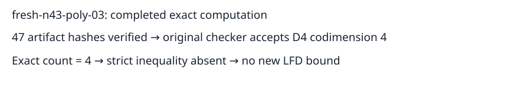

# Completed n43 polynomial-basis input 03 retry

The independent checker accepts a degree-four certificate with codimension 4. Exact enumeration gives 4 solutions. The strict inequality required for the LFD lower-bound criterion is absent. No new LFD lower bound or upper bound is inferred.

All 47 recorded artifact hashes and original request bytes were verified after download. The independent checker was also rerun locally and accepted the certificate. The public archive contains the complete remote evidence, local checker replay and readback receipt. A fresh anonymous GET verified the archive hash and extracted certificate hash; see publication.json.

This is the sixth completed input of the original 32-input continuation. Two completed n42 inputs establish LFD at least 5; four completed n43 inputs yield no new bound. Twenty-six inputs remain unfinished. The failed earlier poly03 attempt remains preserved and is not another sample. The retry follows ../../panel-poly03-retry-protocol.json. No population-frequency or complete-panel claim is made.

Job semaev-panel-n43-poly03-retry-20261029-1742, UID 62239f41-c6b9-4326-841d-ab32e76d5def, completed at 2026-10-29T18:18:32Z. The portable worker passed node-local controls. Shared-host elapsed times are telemetry only, with no performance comparison. Paths and hashes are in readback.json and result.json.

