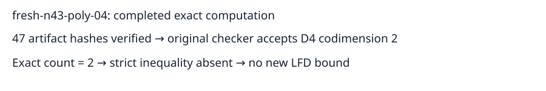

# Completed n43 polynomial-basis input 04

The independent checker accepts a degree-four certificate with codimension 2. Exact enumeration gives 2 solutions. The strict inequality required for the LFD lower-bound criterion is absent. No new LFD lower bound or upper bound is inferred.

All 47 recorded artifact hashes and original request bytes were verified after download. The independent checker was rerun locally and accepted the certificate. The full public archive includes remote outputs, local replay and readback receipt. A fresh anonymous GET verified archive and extracted-certificate hashes; see publication.json. The collection script initially asserted the previous input value 4; this assertion was corrected to the actual value 2 without altering scientific data, as recorded in readback.json.

This is the seventh completed input of the original 32-input continuation. Two completed n42 inputs establish LFD at least 5; five n43 inputs yield no new bound. Twenty-five inputs remain unfinished. Protocol: ../../panel-protocol-v3.json. No population-frequency or complete-panel claim is made.

Job semaev-panel-n43-poly04-v3-20261029-1753, UID ce67147b-e14b-49a2-91d1-587b94541967, completed at 2026-10-29T18:29:08Z. Node-local controls passed. Shared-host elapsed times are telemetry only; no performance comparison is made. Paths and hashes are retained in readback.json and result.json.

