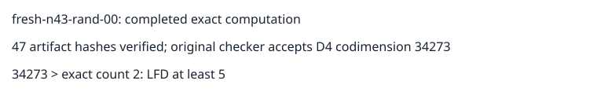

# Certified n43 random-subspace input 00

The original independent checker accepts a degree-four certificate with codimension lower bound 34273. Exact enumeration gives 2 solutions. The strict inequality 34273 > 2 establishes LFD at least 5 for this named input. It establishes no degree-six lower bound or upper bound.

All 47 recorded artifact hashes and the original frozen request bytes were verified after download. The 644339888-byte certificate, checker transcript, exact-count output, environment and commands are retained in the complete evidence archive. Publication verification is recorded separately in publication.json.

This is the eighth completed input of the original 32-input continuation, with three inputs establishing LFD at least 5. Twenty-four inputs remain unfinished. Protocol: ../../panel-protocol-v3.json. No population-frequency or complete-panel claim is made.

Job semaev-panel-n43-rand00-v3-20261029-1822, UID 73d05d00-13dc-4bd7-b9e5-51fbea6a0b92, completed at 2026-10-29T19:07:47Z. Node-local controls and all scientific steps completed successfully. Shared-host elapsed times are telemetry only; no performance comparison is made. Exact paths and hashes are in readback.json and result.json.

