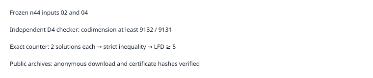

# Two additional n44 certificates

Two additional n=44 polynomial-subspace inputs establish LFD >= 5. The original independent checker accepts degree-four codimension lower bounds 9132 (input02) and 9131 (input04), each strictly greater than the exact count of 2 solutions. No degree-six or upper bound follows.

All 47 artifact hashes per input, frozen request bytes, successful step records, checker transcripts and exact counts were checked after S3 download. Complete public archives were downloaded anonymously and their archive and certificate hashes verified; publication.json records the URLs and digests.

The original 32-input continuation now has 17 completed inputs, including 10 certified LFD >= 5 bounds, and 15 unfinished inputs. Retries are not additional samples. No population-frequency inference is made. Protocol: ../../panel-protocol-v3.json. Shared-host elapsed times are telemetry only. The existing mathematical certificate argument is unchanged; this report extends named-instance evidence only.

