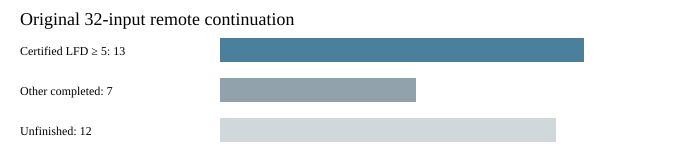

# Certified n44 random input 03

The original independent checker accepts the degree-four certificate for fresh-n44-rand-03 with codimension lower bound 31,780. Exact enumeration gives zero solutions. This establishes LFD at least 5 for this named input. No degree-six or upper bound follows.

All 47 recorded artifact hashes and the frozen request identity were verified after download. All steps returned zero without timeout. Certificate bytes: 597544256; SHA256: 062a1bde11dfab489cdc016aa3f38dc23bd23e0fa315765d602c0a23cf8f56fe. The complete evidence archive passed anonymous download and certificate-hash verification.

The original 32-input remote continuation now has 20 completed inputs, including 13 certified LFD at least 5 bounds; 12 remain unfinished. Retries are not additional draws. No population-frequency conclusion or timing comparison is made.

Job semaev-panel-n44-rand03-v3-20261030-0128, UID eebf7c57-4e49-4317-a1b3-c78be6f64920, completed 2026-10-30T02:04:07Z. Original protocol: ../../panel-protocol-v3.json. The certificate argument is unchanged; this report adds named-instance evidence.

