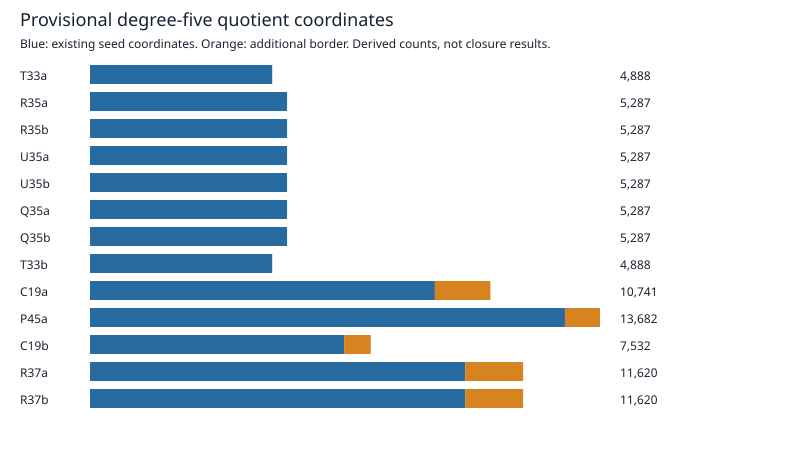

# Historical seed quotient-lift capacity

All 13 frozen historical maps passed hash identity and triangularity checks. Both independent enumeration directions agreed for every map. This is structural analysis of existing certificates, not a degree-five closure run.

| Seed | Variables | Seed coordinates | New border | Working coordinates | Provisional map GiB | Relation basis ceiling GiB |
|---|---:|---:|---:|---:|---:|---:|
| T33a | 34 | 4888 | 0 | 4888 | 0.190 | 0.003 |
| R35a | 36 | 5287 | 0 | 5287 | 0.274 | 0.003 |
| R35b | 36 | 5287 | 0 | 5287 | 0.274 | 0.003 |
| U35a | 36 | 5287 | 0 | 5287 | 0.274 | 0.003 |
| U35b | 36 | 5287 | 0 | 5287 | 0.274 | 0.003 |
| Q35a | 36 | 5287 | 0 | 5287 | 0.274 | 0.003 |
| Q35b | 36 | 5287 | 0 | 5287 | 0.274 | 0.003 |
| T33b | 34 | 4888 | 0 | 4888 | 0.190 | 0.003 |
| C19a | 40 | 9253 | 1488 | 10741 | 0.951 | 0.013 |
| P45a | 46 | 12742 | 940 | 13682 | 2.472 | 0.022 |
| C19b | 40 | 6817 | 715 | 7532 | 0.668 | 0.007 |
| R37a | 38 | 10066 | 1554 | 11620 | 0.793 | 0.016 |
| R37b | 38 | 10066 | 1554 | 11620 | 0.793 | 0.016 |

The payload columns count bits in the proposed representation only. They exclude seed storage, export coexistence, indices, multiplication tables, allocator overhead, the independent checker and other workspaces. They do not establish measured RSS, runtime, a valid admission limit, or any frontier bound.

The next step is a native producer with checked allocation accounting, validation against the reference prototype and dense engine, followed by a separately frozen degree-five run. A candidate map must pass the original independent checker; its checked codimension must exceed the exact solution count to establish LFD >= 6.

Protocol: `../../profile-protocol-v2.json`. Export: `export.json`. Version 1 has no executions; version 2 prospectively corrected the committed instrument identity. Every raw result remains under `raw/`. No source or result was overwritten.

