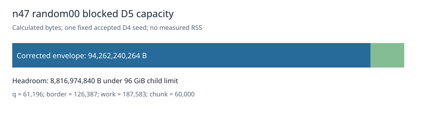

# n47 random00 D5 capacity after the interrupted attempt

The published, independently accepted n47 random00 D4 seed has 61,196 quotient coordinates. Two independent border-enumeration directions both give 126,387 additional coordinates, so a blocked D5 lift has 187,583 working coordinates. At chunk 60,000 the frozen bounded-export source formula gives 68,185,663,280 bytes of base payload. These counts match the separately profiled n47 random02 and random03 seeds; no D5 closure was run in this profile.

The blocked native source also reserves a padded map/seed workspace. Applying its [corrected formula](../../runtime/blocked-envelope-correction-001.json) to this input's equal q and work values gives an additional 1,588,508,128 bytes of payload and a **94,262,240,264-byte** envelope after the source's 135/100 integer margin and 64 MiB reserve. That leaves **8,816,974,840 bytes** under the 96 GiB child limit. This is calculated allocation arithmetic, not observed RSS or a host admission result.

The previous random00 D5 attempt freshly counted zero Boolean solutions, rechecked the D4 seed, and ended when its Spot node shut down; it retained no native checkpoint or D5 certificate. See the [interruption report](../seed-reuse-frontier-interruption-001/report.md) and the [new profile record](../../validation/rand00-envelope-001/result.json). A later blocked rerun would need a new frozen request, runtime admission, and an independently accepted D5 certificate. On this zero-solution input, any accepted positive D5 codimension would establish LFD at least six. The active random02 job and already prepared random03 input retain their execution order.

