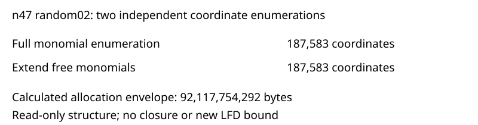

# Next-input dimensions: n47 random02

Observations only. The retained D4 certificate's SHA-256 matches its recorded identity. Both independent enumeration directions give 126,387 border coordinates and 187,583 total working coordinates. Monomial order, unit representatives and triangularity passed structural checks. No closure or independent algebra checker was rerun by this profile.

At fixed chunk60000, the frozen bounded-export producer's five payload terms sum to 68,185,663,280 bytes. Applying its exact source margin (integer135/100 plus64MiB) gives **92,117,754,292 bytes**. This is below the existing 96GiB child limit (103,079,215,104 bytes). It is a calculated allocation gate, not measured RSS, minimum required memory, or observed admission on a host.

The next input can use the existing working-coordinate disk policy: the maximum relation snapshot is 208 + work*ceil(work/64)*8 = 4,398,446,392 bytes. Runtime capacity admission and the final export guard still apply. A large final certificate can remain deferred.

One fixed retained input, two actual enumeration methods, no random draws, retries, exclusions or performance inference. Source commit 171fd3e604415939dd6b051cb6fca51f13c7d4ef; protocol 349131e0b98d4f565b7b0ad1caafc8cde4de470073067cc261618c7a2111498d. The original D4 checker acceptance and count4 are historical records in reports/highmem-rand02-recovery-001. This profile adds no mathematical bound. The next D5 attempt will recheck the seed, freshly count solutions and independently check any D5 output; LFD>=6 requires accepted codimension greater than that fresh count.

