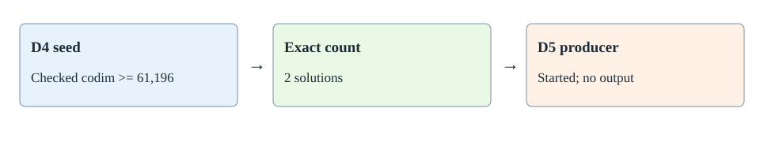

# n47 random03 blocked degree-five terminal record

The original n47 random03 cloud worker completed a fresh independent degree-four seed check and exhaustive solution count. The checker accepted codimension at least 61,196; the counter found two solutions. This retains the named-input last-fall-degree lower bound of five. The degree-five producer started, but Kubernetes marked the Job failed with `BackoffLimitExceeded` and no degree-five certificate, checker result, or native checkpoint was retained. Degree six remains unknown for this input.

The [terminal record](../../runs/rand03-blocked-frontier-terminal-001/terminal.json) binds the Job UID and all 13 objects in the complete S3 run prefix. Every object was read back; byte lengths and single-part ETags matched its downloaded bytes, and SHA-256 hashes are recorded. The independent checker transcript and fresh counter transcript are archived verbatim. The failure cause cannot be established from the retained Job condition or empty pod logs, so no runtime or algorithmic failure claim follows.
