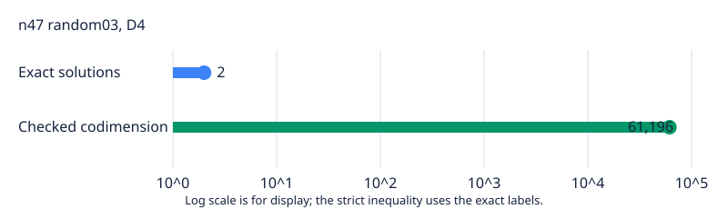

# Certified n47 random03 degree-four seed

The original independent checker accepted the D4 certificate for the exact input `fresh-n47-rand-03`. It checked all 48 variable multiplications and proved `1` is not in `W_4` with codimension at least 61,196. Fresh exact enumeration found 2 solutions. Since 61,196 > 2, this named presentation has last fall degree at least 5. This D4 result is the prerequisite seed for its original D5 continuation; it is not a degree-six result and is not one of the separate 32 panel inputs.

The certificate is 1,632,838,224 bytes, SHA-256 `c27b7a86ddbd1f73c359fd75780f23d577c9b435f6179eb80525607e01bb3d6c`. The terminal wrapper returned 0. The collector verified all 47 worker artifact hashes, the pinned request and system, three per-worker controls, the exact counter, the original checker transcript, and the certificate digest. Controls, count, producer and checker each exited 0 without timeout. Source commit `d015d5e0b7101add8b60e3b368173251408691c2` and frozen protocol hash `db8fad90775e5ffdaf4244167d2999db416e9062905388d6fb43116d6c4df549` bind this original attempt; the runner did not record a working-tree dirty-state flag. This is exact algebra on a shared local host, with no timing comparison.

The public asset is [the D4 certificate](https://github.com/isogeny-labs/crypto-autoresearcher/releases/download/semaev-closure-certificates-20261029/fresh-n47-rand-03-D4-local01.D4.cert.gz). The publication receipt records anonymous HTTPS GET and SHA-256 checks for all three assets, decompression to the original certificate digest, and complete canonical-store GET/hash checks for both stored assets. The local raw certificate remains at `/home/ec2-user/fall-degree-data-20261029/rand03-d4-local-001/attempt-001/certificate.bin`. The accompanying export has two completed rows for the producer/checker and fresh exact count, with no excluded row.

The n47 random02 original D5 cloud job remains separate and active at the time of this report. The next step for this input is to profile this accepted seed's degree-five working coordinates and run its original D5 continuation after the active cloud frontier releases its slot. The local n45 polynomial04 panel attempt is undergoing its frozen memory admission.

