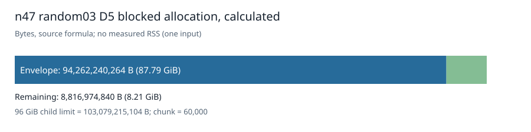

# n47 random03 blocked-lift capacity and arithmetic correction

The accepted n47 random03 D4 seed has 61,196 quotient coordinates. Two independent border-enumeration directions agree on 126,387 additional coordinates, giving 187,583 D5 working coordinates. Its fixed-chunk bounded-export profile has the same counts as n47 random02 and a derived base payload of 68,185,663,280 bytes. These are structural and source-arithmetic results; the profile did not run D5 closure.

The earlier random02 additional-workspace note omitted two padded 64-bit words in each native map and seed stride. The native source uses `((work+63)/64+2)*8` and `((q+63)/64+2)*8` bytes. With 48 variables, q=61,196, work=187,583, and chunk=60,000, the corrected extra payload is 1,588,508,128 bytes. Applying the source's integer 135/100 margin and 64 MiB reserve to base plus extra gives **94,262,240,264 bytes**, leaving **8,816,974,840 bytes** under the 96 GiB child limit. The correction increases the prior recorded envelope by 1,498,780 bytes. The active random02 binary uses its own allocation guard, so the note's error did not control that run.

The immutable raw records are [random03 profile](../../validation/rand03-envelope-001/result.json), [random02 profile](../../validation/rand02-envelope-001/result.json), and [correction](../../runtime/blocked-envelope-correction-001.json). The input seed's original checker acceptance and fresh exact count two are in [the D4 result](../rand03-d4-local-001/report.md). The random03 D5 continuation requires its own frozen request, runtime admission, fresh count, and independently checked D5 certificate. Only accepted D5 codimension above that count establishes LFD at least six for this named input.

