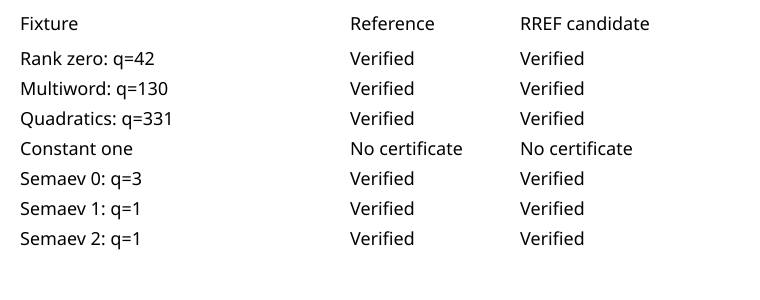

# RREF certificate exporter: fourteen exact controls passed

All fourteen configurations passed: seven fixed systems, each run with the reference reverse-substitution exporter and the separate full-RREF exporter. All twelve completed certificates are byte-identical across the two exporters and satisfy independent quotient-map conditions. The three Semaev fixtures additionally pass the original standalone checker and match the retained reference hashes. Both configurations of the constant-one fixture correctly produce no certificate.

Coverage includes rank zero (codimension 42), a three-word quotient with a partial final word (130), generic quadratic relations (331), constant-one rejection, and three Semaev fixtures with codimensions 3, 1, and 1. Closure construction, column order and stopping rules are unchanged; only the export routine differs. The frozen plan pins every input, binary, checker and test script.

The archive contains 81 files with verified sizes and hashes. Each child had a 1 GiB address-space cap and 180-second watchdog. All fourteen returned zero, with no missing or failed cases. Wall times and resource usage were not recorded as performance measurements. Host metadata was collected after the controls; it is not per-stage instrumentation.

Source commit: b7a1df3a5c423b9ff6cb2266416ad66b30016242. Protocol SHA-256: a04d6a1f08bce8e67c1e103b9961ca2d55677430160c56dc90d7aba62817d0b6. Candidate binary: f4a9b51354d7f6bb4ba7f8afecfacc459f78b96647411f29b0229062cbc7e844. The construction rationale and source references are in RREF-EXPORT.md.

Next: package the candidate with the unchanged worker's per-run controls and independent checker, retaining resource admission and a separately frozen scientific request. The active scientific binaries were not replaced. These controls establish exact agreement on the listed fixtures; a measured runtime comparison has not been performed.

