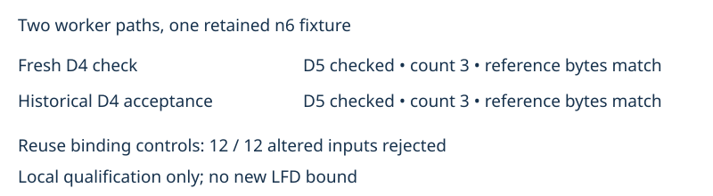

# Historical D4 acceptance reuse controls

Observations only. Two actual local worker paths passed on retained n6 fixture0: a fresh original D4 check and reuse of the original historical D4 acceptance. Both produced the identical retained D5 certificate (SHA-256 7cf2d46d96fe00dfddd1277935c7f0b6577c7ab9cbdc774151c81f56fee82d73), passed the original independent D5 checker, and freshly counted three solutions. Checked codimension is also three, so no new LFD bound follows.

The reuse configuration rejected all twelve altered bindings: capsule digest, seed bytes, target, checker source, failed step, timeout, acceptance transcript, invocation, original request, worker source, transfer receipt, and escaping evidence path. Inner-binding tests re-pin the modified capsule and evidence digests to test the intended binding rather than merely the outer hash. These are twelve assertions inside one worker configuration, not twelve independent mathematical instances.

The historical receipt is not algebraically replayed by the custody verifier. It binds trusted retained checker evidence to identical seed bytes and an identical ordered target. The final D5 check and fresh count remain mandatory. Local fake storage is used; previously retained cloud qualification covers the unchanged checkpoint transport, guard and native producer. This run does not establish frontier success, cloud placement, or a speed advantage. Timings are diagnostic only.

Two requested rows completed once each, with no retries or exclusions. Raw records, commands, manifests, frozen protocol, certificate bytes and rejection receipts accompany this report. No mathematical frontier graph changes because no new bound was obtained.

