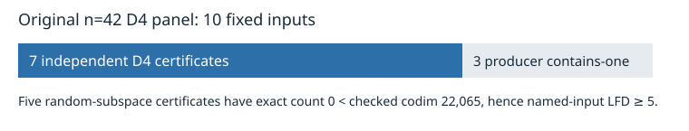

# Recovered n=42 degree-four certificates

Two interrupted original-panel attempts, `fresh-n42-rand-03` and `fresh-n42-rand-04`, had retained complete 329 MB D4 certificate candidates but lacked terminal results. We did **not** rerun the closure producer. The original independent checker accepted both retained certificates with codimension at least 22,065. A fresh pinned exhaustive counter found zero solutions for each, establishing **last fall degree at least 5 for each exact named Boolean presentation**. The original producer exit codes remain unknown.

| Input | Retained certificate SHA-256 | Fresh count | Checked D4 codimension lower bound | LFD lower bound |
|---|---|---:|---:|---:|
| `fresh-n42-rand-03` | `b7385138fc7b6305c46b6a4a6d8f603feb3af760bfe9e48108710e57e0676d23` | 0 | 22,065 | 5 |
| `fresh-n42-rand-04` | `e09408def99b82cc943bed7df687a33d5dc2f8879ea4bf48662ba070e127af7b` | 0 | 22,065 | 5 |

The original n=42 D4 panel now has 10/10 terminal attempts: seven accepted certificates and three producer contains-one outputs. Five of the seven certificates have the strict count gap needed for LFD ≥ 5. The two recovered certificate files, receipts, evidence archives, and publication acknowledgements are in the [public release](https://github.com/isogeny-labs/crypto-autoresearcher/releases/tag/semaev-closure-certificates-20261029); each asset passed anonymous HTTPS and canonical S3 download/hash readback. [Raw recovery records](../../runs/n42-retained-recovery-001/manifest.json) bind all small transcripts and results. The certificate binaries are in the release.
