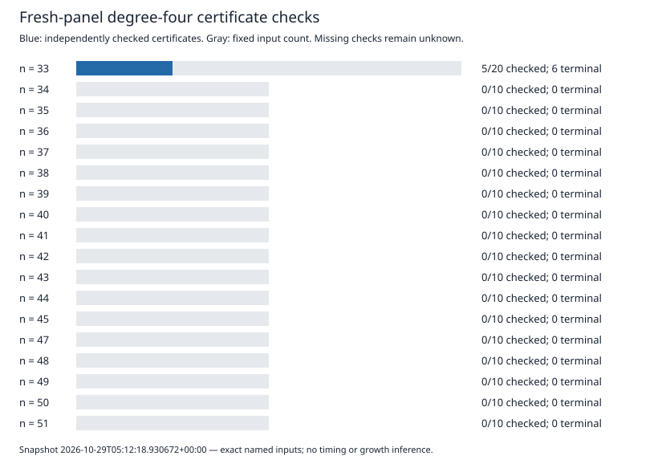

# Certificate data progress

2026-10-29T05:12:18.930672+00:00

Historical certificates: **13/13** independently checked with historical hash identity.
Public certificates with complete download/hash readback: **16**.
Fresh exact solution counts completed: **8/190**.

The 190 input records and 240 closure requests are a fixed plan. Pending cells carry no measured result.

| n | Inputs | D4 terminal | D4 certificates | LFD ≥ 5 inferred | D5 terminal | LFD ≥ 6 inferred |
|---:|---:|---:|---:|---:|---:|---:|
| 33 | 20 | 6 | 5 | 0 | 0 | 0 |
| 34 | 10 | 0 | 0 | 0 | 0 | 0 |
| 35 | 10 | 0 | 0 | 0 | 0 | 0 |
| 36 | 10 | 0 | 0 | 0 | 0 | 0 |
| 37 | 10 | 0 | 0 | 0 | 0 | 0 |
| 38 | 10 | 0 | 0 | 0 | 0 | 0 |
| 39 | 10 | 0 | 0 | 0 | 0 | 0 |
| 40 | 10 | 0 | 0 | 0 | 0 | 0 |
| 41 | 10 | 0 | 0 | 0 | 0 | 0 |
| 42 | 10 | 0 | 0 | 0 | 0 | 0 |
| 43 | 10 | 0 | 0 | 0 | 0 | 0 |
| 44 | 10 | 0 | 0 | 0 | 0 | 0 |
| 45 | 10 | 0 | 0 | 0 | 0 | 0 |
| 47 | 10 | 0 | 0 | 0 | 0 | 0 |
| 48 | 10 | 0 | 0 | 0 | 0 | 0 |
| 49 | 10 | 0 | 0 | 0 | 0 | 0 |
| 50 | 10 | 0 | 0 | 0 | 0 | 0 |
| 51 | 10 | 0 | 0 | 0 | 0 | 0 |

The n=33 total includes ten separately labelled trace-zero inputs. Every other n has five polynomial and five random-subspace inputs.

A certificate proves W_D ⊆ ker(π), hence a codimension lower bound. The fresh-panel inference additionally uses the exhaustive solution count. A producer report that 1 belongs to W_D is retained without upgrading it to an independently checked certificate.

Sources: `rows.json`, the copied completed records under `evidence/`, the frozen protocols, and `planned-inputs.json`. No pending result has been imputed.
