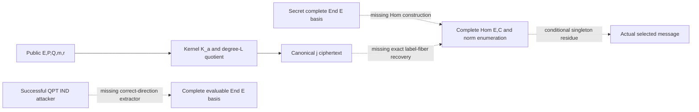

# LABELLED-NORM-HOM-LIFT: one construction-gap attempt

TASK-20261013-f8430e, BATCH-d92210, GOAL-SSI-2fa82a, 2026-10-13.
Author: idea-generator-ideal-hom. Exactly one mechanism; zero scientific,
implementation, formalizer, benchmark, or parameter-selection runs. This is a
named construction gap, not a complete PKE, security theorem, novel scheme, or
impossibility result. All O1–O6 remain open.

The attempted operation is to invert a message-labelled smooth cyclic quotient
using a norm-constrained Hom module. The public sender needs no ring. Given a
maximal supersingular E/F_(p^2), a full public basis (P,Q) of E[L], L=2^e dividing
p+1, and M=2^mu dividing L, it encodes m in [0,M) by choosing uniform
r in [0,L/M), setting a=m+Mr, forming K_a=<P+[a]Q>, and publishing only
c=j(E/K_a). No endpoint hash, mask, line transfer, or authentication wrapper is
used. Quotient evaluation is an e-step degree-two chain computed from the
supplied kernel generator. The first changed operation from CEST is inversion
of a quotient endpoint to a labelled kernel; CEST instead uses
psi([r]P)=[r]psi(P) on a public line.

The intended recipient receives only pk and a complete efficiently evaluable
rank-four End(E) basis B. The missing operation is
LabelledNormHomLift(E,B,P,Q,L,c): obtain a complete efficiently evaluable
Hom(E,C) lattice for a model C with j(C)=c, enumerate all degree-L separable
maps whose kernels equal some K_a, and return the resulting label residues
a mod M. Hom(E,C) is a right End(E)-module by precomposition. Degree is its
positive-definite norm. A kernel gives the left ideal
I_K={alpha in End(E): alpha(K)=0}; postcomposition preserves this ideal.
Neither describing this ideal nor knowing End(E) supplies a public ciphertext's
ideal, a connecting map, Hom basis, principalization algorithm, or bounded
norm enumeration. Those are requirements, not available oracles. The sender
never computes a hidden ideal or hidden-ring action.

An exact finite reference decoder enumerates every a in [0,L), recomputes
j(E/K_a), and returns m iff the set of matching residues is the singleton {m};
otherwise it returns bottom. This establishes a finite definition, with
O(L) quotient evaluations, and is also the identical public-data control. It
does not implement an efficient recipient trapdoor. A proposed Hom decoder
must agree with this exact set, not select an arbitrary isogeny or message.

For every valid pk and every selected m, reference correctness is exactly the
probability over r that every a' with j(E/K_a')=j(E/K_(m+Mr)) satisfies
a' mod M=m. No negligible bound is supplied. Two different message labels in
one endpoint fiber refute perfect correctness for those coins, irrespective of
which complete ring representation is secret. Returning an orbit, a norm,
one arbitrary kernel, or a fixed invariant is insufficient. A fresh random
encryption retry cannot repair an unrecognized cross-message collision.

The declared prospective hard distribution and exact finite KeyGen, canonical
bytes, threat model, QPT games, costs, and missing algorithms appear in
public-statement.yaml. Its finite certificate-enumeration key sampler has no
polynomial-time bound and no established hardness; it is not silently equated
with uniform supersingular EndRing. The efficient design therefore already
needs a distribution-matched sampler as well as the Hom lift. No retained
connecting isogeny, ideal, orientation, secret target ring, or torsion-action
table is smuggled into Dec.

The confidentiality target is a separately named LABELLED-QUOTIENT-IND game,
with exactly this public key and ciphertext law. A distinguisher might learn
only a message partition, not a kernel, Hom map, OneEnd output, or rank-four
ring. The missing security arrow is
successful QPT LABELLED-QUOTIENT-IND attacker -> complete evaluable EndRing(E).
Neither EndRing(E) -> hypothetical decryptor nor Hom(E,C) -> one quotient
preimage proves that arrow. There is no supplied loss, simulator/extractor
theorem, or adaptive OneEnd compiler.

The base model is QPT IND-CPA in the standard model, with classical challenge
messages/ciphertexts and public encryption computable coherently if its circuit
is supplied. No random oracle is used: q_H=0, hence no QROM programming or
rewinding theorem is invoked. Quantum security is unestablished. A separate
IND-CCA2 target uses classical adaptive decryption queries and exact byte
challenge exclusion. It is defined for audit only; no active-security claim or
transform is supplied.

Controls are derived symbolically in recipient-strictness.yaml: remove B;
replace B by a challenge-specific norm-L Hom witness; restrict to scalar maps;
hold the entire endpoint transcript fixed across all its kernel fibers; and
leak the kernel label. The finite public enumeration costs O(L), so a
polynomial-size L does not yield recipient asymmetry. No theorem says one Hom
map, or even a successful message decoder, identifies a complete ring. These
are scoped ceilings, not universal EndRing-PKE obstructions.

The current NIST security-criteria page and its linked call document were
retrieved and inspected. Category 5 compares attack resources with AES-256 key
search across relevant metrics; the page's preliminary guidance gives
2^272 classical gates and 2^298/MAXDEPTH quantum gates, not a claim that a
256-bit prime achieves Category 5. The full concrete plan is in
cat5-evidence-plan.yaml. No parameter set or resource estimate for this
mechanism was selected or measured.

Primary metadata/abstracts for SiGamal/C-SiGamal, LIT-SiGamal and UPKE were read.
Their PDF retrievals returned HTTP 403. The Seta title search locates
ePrint 2019/1291 and corrects the incomplete local author list; it is not a
full construction read. This lens is adjacent to isogeny trapdoor inversion
and requires normalized primary comparisons before novelty can be assessed.
Novelty remains unverified. source-ledger.yaml records inspected extent,
failed routes, all retained captures and hashes, and internal inputs.

This editable diagram is producer input to the separately assigned
TASK-20261013-9e1246 report/diagram/PDF task; it is not a rendered PDF or an
independently reviewed finding. Canonical predecessor graph content is not
changed by this gap packet.

Required next discriminating obligation: supply one exact, polynomial-time,
distribution-matched LabelledNormHomLift with a complete fiber correctness
bound and a smaller-witness separator. A collision witness would refute only
the affected message domain/coins; a lift without full-ring extraction would
support only the named intermediate relation. No automatic successor or run is
authorized. The existing problem
problems/eigenx-cest-endring-reduction-not-established.md remains relevant;
the Coordinator was notified to record this additional Hom-lift gap because
shared problem/index writes lie outside this task's scope.

Inference: requested research-deep -> anthropic:claude-sonnet-5-5, high,
unverified; actual gpt-6.1-sol high native fallback; fallback_used=true,
model_verified=false, degraded_allowed=false. Native authentication does not
verify model identity. dominated_by: n/a (no result claimed).
sota_delta: no attack/performance advantage claimed; no matched measurements.

Checks at handoff: artifact syntax and required-file checks are administrative
only. Independent review is pending. Filling this packet discharges no scheme
obligation and changes no official scientific status.
