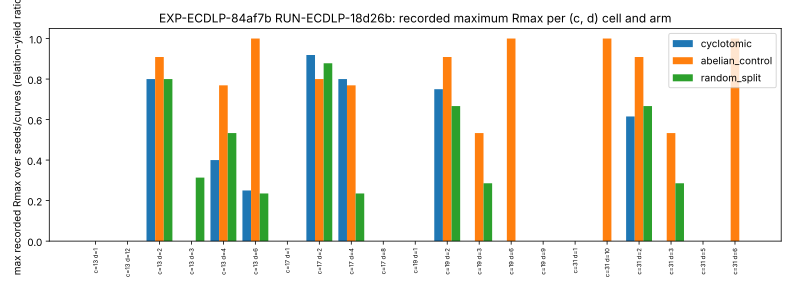

# Run report: EXP-ECDLP-84af7b (RUN-ECDLP-18d26b)

This report describes recorded outputs only. It states no verdict, support, weakening or significance; those belong to the evidence review. A failed process is an operational fact, not a mathematical refutation.

## What ran

| Item | Value |
| --- | --- |
| Experiment / hypothesis / goal | EXP-ECDLP-84af7b / H-ECDLP-2f1033 / GOAL-ECDLP-001 |
| Executor task / run id | TASK-20261017-2cc75e / RUN-ECDLP-18d26b |
| Run directory | experiments/EXP-ECDLP-84af7b/runs/RUN-ECDLP-18d26b/ |
| Command | `g1 --c 13 17 19 31 --dmax 12 --ladder 300 1000 3000 10000 30000 100000 --curves 7 --abelian-controls 3 --random-fields 2 --seeds 1 2 3 --aux-primes 8` (Rust, pari feature off, built with `--locked`) |
| Host | linux x86_64, 4 cores, 15 GB |
| Wall time | 1366.1 s runner-recorded (measured); supervisor started 21:02:04 and finished 21:25:16 UTC |
| Trials | 1 requested, 1 process completed (returncode 0), 0 failed, 0 timed out |
| Checker | `check.py` exited 0, `problems: []` (measured) |
| Supervisor status | `invalid_output`: manifest.yaml fails the run schema, "expected top-level key 'run'" |

The invalid_output status is an output-format impediment. The computation finished, the checker passed, and every artifact is preserved unmodified. The same flat manifest layout is written by the other three SNFS-G runners, so they were not launched; see the session summary.

## Recorded values

All values are read from raw-result.json. Counts are measured; "max" is the maximum of recorded per-curve values and is derived by scanning them.

| Quantity | Value |
| --- | --- |
| Cells recorded | 2087 |
| Curves recorded | 7 |
| Summary keys (c, d) | 21 |
| Trace-relation failures total | 0 |
| Recorded Rmax rows: cyclotomic / abelian control / random split | 441 / 1071 / 553 |
| Largest recorded Rmax, cyclotomic | 0.9189 at c=17 d=2 |
| Largest recorded Rmax, abelian control | 1.0 at c=31 d=6 |
| Largest recorded Rmax, random split | 0.8780 at c=17 d=2 |

Missing data: summary fields that the runner recorded as null (for example controls at degrees where no control field exists) are shown as absent bars in the graph.

## Graph

Figure: RUN-ECDLP-18d26b, n = 21 (c, d) cells, three arms. Bars are the maximum recorded Rmax over the recorded seeds and curves. No new computation beyond that maximum. Drawn by make_graph.py from raw-result.json.
