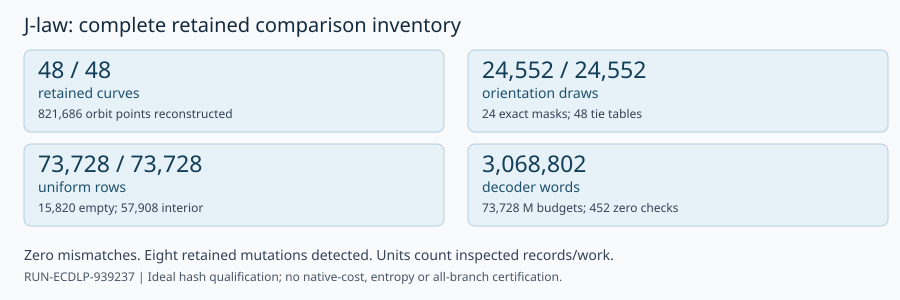

# Retained host-reference random-law audit

TASK-20261030-3393bd · J-law · RUN-ECDLP-939237 · 2026-10-30 UTC

**Verdict: holds within the complete retained inventory under the declared ideal independent-hash model.** Independent deterministic reconstruction found zero mismatches. This is a bounded component result; physical entropy, independent stages, unexercised branches and native costs remain unqualified. The prior historical inconclusive review and all scientific statuses remain unchanged.

| Independently inspected quantity | Actual coverage |
|:---|---:|
| Retained curves / reconstructed orbit points | 48 / 821,686 |
| Eligible masks / orientation draws | 24 / 24,552 |
| Retained reference statistics / tie tables | 24,552 / 48 |
| Decoder budgets / complete decoder words | 73,728 / 3,068,802 |
| Uniform lists / empty / interior budgets | 73,728 / 15,820 / 57,908 |
| Separately counted zero checks / capped cells | 452 / 381 |
| Retained mutation controls detected | 8 of 8 |

The audit read every one of the 48 declared uniform files, including 24 legitimate empty calibration files, and every one of the 24 calibration null files. All raw single rows (345,600), traces (36,864) and decoder cells (73,728) were streamed once. Each confirmation curve supplied 3,072 conditional uniform rows. Recorded M ranged from 0 to 91.

\newpage

## Law and independent method

For bound b and a uniform 256-bit proposal U, let T = b floor(2^256/b). Accept U below T and return U modulo b. Every residue has the same number of accepted preimages. Source inspection fixed counter0, eight-byte big-endian counters, full-digest big-endian reduction, NUL separators and the literal local domains; these details were explicitly underspecified in the blind definitions.

The independent replay derived each local seed as SHA256(master concatenated with its exact namespace). Orientation bits used the retained null namespace and were packed MSB first with zero trailing padding. All 198,521,334 null blocks agreed; their recorded accepted/block counts and all 24,827,187 packed storage bytes agreed. Uniform replay used a dense explicit-array Fisher–Yates construction, structurally distinct from the producer's sparse swap map. Every guess, public check, effective budget, success flag, storage count and stream count agreed across 1,139,829 uniform blocks. No raw hash rejection occurred. These are reconstructed logical counts, not qualified native measurements.

On each same retained curve, affine group equations reconstructed its finite orbit. Solving the cyclic slope-cocycle equations reconstructed the full primary mask. Exactly the paired nonzero defined positions became free coordinates; +1 was pinned0 and -1 pinned1. With D defined sign pairs, support is 2^(D-1). Each of 1,023 draws per eligible curve was compared in order. Exact masks, support objects, padding, duplicate counts, sorted multiplicities and multiplicity-weighted ties agreed. There were zero duplicate orientation draws. Retained point/start duplicates were preserved. All 88,190,784 declared diagnostic lookups were reconciled by algebra on the same retained banks and starts; no full-orbit recovery census or new bank was created.

Every cell budget was independently reconstructed from its retained trace bits by exhaustive permitted erasure assignments and Hamming flips, binary interval inequalities and scalar conversion. Distinct legal nonzero scalars formed M; zero checks stayed separate. For N=r-1 and m=min(M,N), the conditional without-replacement hit law is m/N. With replacement the expression would instead be 1-(1-1/N)^m. The six cells share targets, blindings, traces and data-dependent budgets; domain separation does not make these independent scientific trials or make the matched-M reference a standalone solver.

## Sensitivity and limits

The fixed public byte alphabet0..255/bound10 distinguishes biased modulo reduction (counts26 or25) from rejection (25 each). Public Z7 fixtures detect wrong anchors, asymmetric masks, lost multiplicity, zero and duplicate guesses. Tiny copies of the first retained witnesses additionally detected eight mutations: seed byte, local domain, counter start, counter endian, draw bit, multiplicity, duplicate guess and zero guess. Their exact source rows and changed prefixes are in checks.json.

No retained case exercised an ineligible or degenerate mask, actual orientation duplicates, saturation, or raw SHA rejection. Those branches are not certified by this replay. Every observed mask had 305–26,193 free bits. A fixed deterministic generator with a real 256-bit seed has at most 2^256 complete sequences; symbolic full support and iid fairness are model statements, not consequences of byte agreement. The source explicitly declares its ideal independent-hash model. This distinction is a qualification, not an observed reference failure.

The host seed record lacks a UTC draw timestamp and OS entropy transcript. Retained bytes and source order do not prove physical entropy or late independent generation. Worker PRNG/curve sampling, native clocks/counters, RSS, I/O, currency and energy are outside this component replay. No pattern p-value, advantage, mechanism, exponent, family closure or whole-claim verdict is inferred.

\newpage

## Evidence and chronology

The independent phase1 derivation used only the twelve allowed files. The original protocol/specification/trial records contain historical source-review, failure and provenance metadata; that permitted exposure is disclosed without claiming sanitized inputs. Every actual canonical file open was logged before access. No sibling review was read in either phase.

- Blind derivation generated: **2026-10-30 03:36:07.098270 UTC**.
- Immutable seal: **03:36:07.099302 UTC**; derivation SHA256 prefix `7a5b438c98df`.
- Root release recorded: **03:38:19.737965 UTC**, followed by explicit root ACK; release SHA256 prefix `fe9fab09a48a`. Full digests are in checks.json/read-attestation.yaml.
- Complete independent retained comparison: **2026-10-30T03:45:08.841609Z** to **2026-10-30T03:47:50.026452Z**, command exit0.

Primary source locations (all exact content hashes and actual read events appear in checks.json/read-attestation.yaml):

- Frozen definitions: experiments/EXP-ECDLP-080f41/protocol.json, specification.yaml and trial-plan.json.
- Source inspected after release: harness/classical_ecdlp_controlled_followup/host/reference.py, host/verify.py and postrun/run_postrun.py. No producer module was imported or called.
- Same retained public cohort and three raw streams: BATCH-cbf9d7/derived-supervisor-views/RUN-ECDLP-939237/manifest-json-v1/supervisor/modal/collected/.
- Same retained host seed, 24 null and 48 uniform payloads: experiments/EXP-ECDLP-080f41/postrun-from-view-346631/.

The smallest retained sensitivity witness is null-discovery-10-0.json, draw0/free-bits0..63: retained prefix `b6687149da00e772`; the four altered seed/domain/counter fixtures produce different prefixes, retained verbatim in checks.json. Duplicate/zero guess mutations use uniform-confirmation-A-10-0.jsonl row3, cell target0000/rep0/t1.e0. No source bytes were edited.

Canonical publication consists of this report, checks, exact read attestation, unchanged derivation/seal, independent audit.py, editable SVG and inspected PDF plus visual-inspection.json. The report and SVG templates are embedded in audit.py. Root owns canonical writes/publication and separately inspects every PDF page. No canonical graph was modified: this audit changes no scientific relationship or status.

Requested inference policy: review-adversarial/xhigh in a fresh independent session. Serving model remains unverified; no provider probe or model identity is claimed. Literature scope is the exact allowed internal primary definitions/source only; no novelty or literature-completeness claim.

**review_attestation:** joints_owned=[Host reference PRNG and random law]; verdicts={Host reference PRNG and random law: holds} in the bounded scope above; read_sibling_reports=false; blind_from_respected=true. The complete machine-readable timeline, including all39 phase1 file reads and exact seal/unblind events, is read-attestation.yaml.
