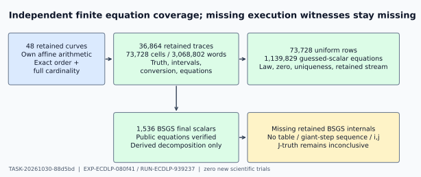

The assigned joint is **inconclusive**. All inspected finite public-equation,
truth-label, interval, conversion and uniform-list consistency checks passed.
The retained BSGS outputs omit the baby tables, giant-step sequences and explicit
collision indices needed for full internal-witness coverage. Correct final
scalars do not fill that gap. This report makes no whole-claim decision.



The fixed inventory is EXP-ECDLP-080f41, RUN-ECDLP-939237. The native
`invalid_output/check1/publishedfalse` outcome remains unchanged. No scientific
trial, new curve, target, nonce, entropy draw, producer import, source execution,
solver experiment or referencebank was created.

## Observation

| Independently checked retained population | Exact count |
|:--|--:|
| Curves, exact prime order and full curve cardinality | 48 |
| Same-curve orbit entries, including identities | 821,686 |
| Retained prepared-base setup equations | 216 |
| Calibration single-point label classifications | 345,600 |
| Trace rows / original attempts / incremental attempts | 36,864 / 36,864 / 12,288 |
| Original / incremental forward-doubling query equations | 516,096 / 172,032 |
| Decoder cells / enumerated word records | 73,728 / 3,068,802 |
| Legal word records / zero-scalar checks | 1,140,281 / 452 |
| Decoder public equations, including failed candidates | 2,280,562 |
| Retained host truth-geometry rows | 73,728 |
| Distinct public targets / BSGS final scalar equations | 1,536 / 1,536 |
| Uniform files / legitimately empty calibration files | 48 / 24 |
| Uniform rows: successes / failures | 404 / 73,324 |
| Uniform guessed-scalar equations / zero-M rows | 1,139,829 / 15,820 |
| Retained uniform saturation rows | 0 |

All expected per-curve row and target-ID populations were reconciled.
`checks.json` preserves every check count, status distribution, per-curve count,
source-file digest, and minimal control witness. Its failures array contains
0 entries. Undefined, empty, capped, zero, failed-verification
and successful rows are retained in the checked population.

## Comparison and independent method

The blind derivation fixed the convention lower scalar half = 0, upper half = 1,
forward doubling, and scalar recovery `x = a * inverse(b) * k mod r`.
Phase-two source transcription resolved the earlier encoding qualification:
`host/verify.py` lines 309–317 and `engine.py` lines 81–138 use that convention.
For `D=2^L`, a binary word `W` requires `rW <= Dk < r(W+1)`.
The source additionally retains a scalar-zero interval check; zero is excluded
from the distinct nonzero budget M, as the sealed derivation required.

Own integer affine group formulas reconstructed only the SAME retained curves.
Each orbit closes for the first time at r; deterministic field point-counting
also confirms the full curve cardinality. Their maps support public-equation
comparisons and independently determined half truths. They are audit scratch,
never candidate advice. No producer Group, Oracle, BSGS, decoder or reference
function was imported or called.

Every original and incremental trace point, scalar interval, conversion and
public check was compared. All 216 retained setup bases were independently
checked against their original base and declared multiplier, with exact setup
IDs and model bindings. Every retained decoder word was reconstructed from
integer bit masks, exact ceiling inequalities and the sealed error/erasure
law. All calibration score denominators and error/erasure histograms, every
host truth geometry, and every uniform success and failure were checked.
Uniform guesses were canonical, nonzero and distinct; exact K/(r-1), empty-M
and saturation metadata and all guessed-scalar equations were checked. Existing
SHA256 streams were replayed without entropy to check retained consistency.

All 1,536 retained BSGS scalars satisfy their fixed target equations.
The width and count-implied decomposition are consistent with own arithmetic.
These derived indices are explicitly not retained collision witnesses. The
source `host/reference.py` lines 37–75 serializes scalars and count vectors,
without its baby table, giant-step sequence or explicit collision `(i,j)`.

## Controls

All 17 phase-two genuine/known-false sensitivity controls passed.
They include actual retained BSGS wrong scalar, sign, zero and noncanonical
mutations; a retained truth-bit mutation; uniform false check, zero, duplicate
and denominator mutations; a retained recovered-scalar conversion mutation;
and fixed-public C11 genuine/mutated collision and decomposition controls.
Mutually consistent false duplicate/zero metadata is still refused. The sealed
phase-one note separately records 23 fixed-toy controls, including exhaustive
C11 subset inclusion for M=0 through saturation, F11 membership/order, and exact
interval boundaries. Toy controls certify only those controls.

## Inference and limitation

The finite equation and truth-label consistency component holds within this
complete inspected inventory. The assigned joint stays inconclusive because
retained internal BSGS table/step/collision witnesses are absent. This is an
evidence gap, not a mathematical failure or a negative scientific outcome.
An explicit table/step/collision artifact bound to the existing computation,
if available, would permit that missing verification; a newly executed source
reference would be a different observation and is outside this audit.

Native event counters, clocks, physical memory, energy and currency remain
unqualified. Logical count consistency does not qualify source execution.
Uniform stream consistency assumes the stated ideal-hash distribution model;
it does not prove randomness or independence. Observed branch counts bound
coverage; fixed-toy saturation does not establish retained saturation coverage.
There is no benchmark, speedup, exponent, significance, attack, closure or
whole-claim inference.

## Provenance and reproducibility

The unchanged blind derivation and seal were published in commit
`6f1a20fad9`; the release was published in `abc17d567a`, with root ACK records
in `246078079c`. Release SHA-256:

```text
1444591d6e8c3b036454b47183f249040dcbb199119f3d5d1f31ddf64b782ba5
```

All 34 phase-one canonical reads predate derivation generation. Every phase-two
source open was recorded before the read and after release. Artifact seal and
release timestamps are copied exactly, not reconstructed message times.
The requested policy is review-adversarial/xhigh; the serving model remains
unverified and no probe was invented. No sibling report was read.

Exact source hashes and row-level control bindings are in `checks.json`;
the complete chronological `review_attestation` is in `read-attestation.yaml`.
Primary data sources are the allowlisted view's `public-cohort.json`, raw
`single-points.jsonl`, `traces.jsonl`, and `decoder-cells.jsonl`, plus retained
`calibration.json`, `host-cells.jsonl`, `references.json`, `host-seed-event.json`
and all 48 uniform files. Internal primary contracts/specifications were read;
their historical references were not independently retrieved. No novelty or
literature-completeness claim is made.

Coverage is for retained accepted public points and the listed mathematical
records. Coordinate proposal/rejection internals, full candidate predicate
mathematics and native execution/cost instrumentation are outside this joint.

Reproduce with `python audit.py`; render with `python audit.py --render`.
The editable report and diagram source is embedded in `audit.py`. Every PDF
page must be visually inspected and recorded in `visual-inspection.json`.

```json
{
  "review_attestation": {
    "task_id": "TASK-20261030-88d5bd",
    "joints_owned": [
      "Truth labels, uniform budget and BSGS equations"
    ],
    "verdicts": {
      "Truth labels, uniform budget and BSGS equations": "inconclusive"
    },
    "sources_read": [
      "coordination/goals/GOAL-ECDLP-e70832/batches/BATCH-128d4e/plans/TASK-20261030-88d5bd.json",
      "ledger/handoffs/TASK-20261030-88d5bd.yaml",
      "coordination/goals/GOAL-ECDLP-e70832/batches/BATCH-128d4e/statements/TASK-20261030-88d5bd.json",
      "AGENTS.md",
      "agents/validator.md",
      ".claude/skills/research-visuals/SKILL.md",
      "docs/agent-contract-extended.md",
      "experiments/EXP-ECDLP-080f41/protocol.json",
      "docs/lab-contract.md",
      "experiments/EXP-ECDLP-080f41/specification.yaml",
      "experiments/EXP-ECDLP-080f41/trial-plan.json",
      "docs/agent-contract-supplement.md",
      "coordination/goals/GOAL-ECDLP-e70832/batches/BATCH-128d4e/releases/TASK-20261030-88d5bd.json",
      "harness/classical_ecdlp_controlled_followup/host/reference.py",
      "harness/classical_ecdlp_controlled_followup/host/verify.py",
      "harness/classical_ecdlp_controlled_followup/engine.py",
      "harness/classical_ecdlp_controlled_followup/curve.py",
      "experiments/EXP-ECDLP-080f41/postrun-from-view-346631/references.json.blob.json",
      "experiments/EXP-ECDLP-080f41/postrun-from-view-346631/.artifacts.json",
      "experiments/EXP-ECDLP-080f41/runs/RUN-ECDLP-939237/modal-evidence.tar.gz.blob.json",
      "coordination/goals/GOAL-ECDLP-e70832/batches/BATCH-cbf9d7/derived-supervisor-views/RUN-ECDLP-939237/manifest-json-v1/view-provenance.json",
      "experiments/EXP-ECDLP-080f41/runs/RUN-ECDLP-939237/raw-result.json",
      "coordination/goals/GOAL-ECDLP-e70832/batches/BATCH-cbf9d7/derived-supervisor-views/RUN-ECDLP-939237/manifest-json-v1/supervisor/modal/collected/public-cohort.json",
      "coordination/goals/GOAL-ECDLP-e70832/batches/BATCH-cbf9d7/derived-supervisor-views/RUN-ECDLP-939237/manifest-json-v1/supervisor/modal/collected/raw/traces.jsonl",
      "coordination/goals/GOAL-ECDLP-e70832/batches/BATCH-cbf9d7/derived-supervisor-views/RUN-ECDLP-939237/manifest-json-v1/supervisor/modal/collected/raw/single-points.jsonl",
      "coordination/goals/GOAL-ECDLP-e70832/batches/BATCH-cbf9d7/derived-supervisor-views/RUN-ECDLP-939237/manifest-json-v1/supervisor/modal/collected/raw/decoder-cells.jsonl",
      "experiments/EXP-ECDLP-080f41/postrun-from-view-346631/references.json",
      "experiments/EXP-ECDLP-080f41/postrun-from-view-346631/host-cells.jsonl",
      "experiments/EXP-ECDLP-080f41/postrun-from-view-346631/uniform-confirmation-A-10-0.jsonl",
      "experiments/EXP-ECDLP-080f41/postrun-from-view-346631/calibration.json",
      "harness/classical_ecdlp_controlled_followup/postrun/run_postrun.py",
      "experiments/EXP-ECDLP-080f41/postrun-from-view-346631/host-seed-event.json",
      "experiments/EXP-ECDLP-080f41/postrun-from-view-346631/uniform-discovery-10-0.jsonl",
      "experiments/EXP-ECDLP-080f41/postrun-from-view-346631/uniform-discovery-10-1.jsonl",
      "experiments/EXP-ECDLP-080f41/postrun-from-view-346631/uniform-discovery-10-2.jsonl",
      "experiments/EXP-ECDLP-080f41/postrun-from-view-346631/uniform-discovery-10-3.jsonl",
      "experiments/EXP-ECDLP-080f41/postrun-from-view-346631/uniform-discovery-13-0.jsonl",
      "experiments/EXP-ECDLP-080f41/postrun-from-view-346631/uniform-discovery-13-1.jsonl",
      "experiments/EXP-ECDLP-080f41/postrun-from-view-346631/uniform-discovery-13-2.jsonl",
      "experiments/EXP-ECDLP-080f41/postrun-from-view-346631/uniform-discovery-13-3.jsonl",
      "experiments/EXP-ECDLP-080f41/postrun-from-view-346631/uniform-discovery-16-0.jsonl",
      "experiments/EXP-ECDLP-080f41/postrun-from-view-346631/uniform-discovery-16-1.jsonl",
      "experiments/EXP-ECDLP-080f41/postrun-from-view-346631/uniform-discovery-16-2.jsonl",
      "experiments/EXP-ECDLP-080f41/postrun-from-view-346631/uniform-discovery-16-3.jsonl",
      "experiments/EXP-ECDLP-080f41/postrun-from-view-346631/uniform-validation-10-0.jsonl",
      "experiments/EXP-ECDLP-080f41/postrun-from-view-346631/uniform-validation-10-1.jsonl",
      "experiments/EXP-ECDLP-080f41/postrun-from-view-346631/uniform-validation-10-2.jsonl",
      "experiments/EXP-ECDLP-080f41/postrun-from-view-346631/uniform-validation-10-3.jsonl",
      "experiments/EXP-ECDLP-080f41/postrun-from-view-346631/uniform-validation-13-0.jsonl",
      "experiments/EXP-ECDLP-080f41/postrun-from-view-346631/uniform-validation-13-1.jsonl",
      "experiments/EXP-ECDLP-080f41/postrun-from-view-346631/uniform-validation-13-2.jsonl",
      "experiments/EXP-ECDLP-080f41/postrun-from-view-346631/uniform-validation-13-3.jsonl",
      "experiments/EXP-ECDLP-080f41/postrun-from-view-346631/uniform-validation-16-0.jsonl",
      "experiments/EXP-ECDLP-080f41/postrun-from-view-346631/uniform-validation-16-1.jsonl",
      "experiments/EXP-ECDLP-080f41/postrun-from-view-346631/uniform-validation-16-2.jsonl",
      "experiments/EXP-ECDLP-080f41/postrun-from-view-346631/uniform-validation-16-3.jsonl",
      "experiments/EXP-ECDLP-080f41/postrun-from-view-346631/uniform-confirmation-A-10-1.jsonl",
      "experiments/EXP-ECDLP-080f41/postrun-from-view-346631/uniform-confirmation-A-10-2.jsonl",
      "experiments/EXP-ECDLP-080f41/postrun-from-view-346631/uniform-confirmation-A-10-3.jsonl",
      "experiments/EXP-ECDLP-080f41/postrun-from-view-346631/uniform-confirmation-A-13-0.jsonl",
      "experiments/EXP-ECDLP-080f41/postrun-from-view-346631/uniform-confirmation-A-13-1.jsonl",
      "experiments/EXP-ECDLP-080f41/postrun-from-view-346631/uniform-confirmation-A-13-2.jsonl",
      "experiments/EXP-ECDLP-080f41/postrun-from-view-346631/uniform-confirmation-A-13-3.jsonl",
      "experiments/EXP-ECDLP-080f41/postrun-from-view-346631/uniform-confirmation-A-16-0.jsonl",
      "experiments/EXP-ECDLP-080f41/postrun-from-view-346631/uniform-confirmation-A-16-1.jsonl",
      "experiments/EXP-ECDLP-080f41/postrun-from-view-346631/uniform-confirmation-A-16-2.jsonl",
      "experiments/EXP-ECDLP-080f41/postrun-from-view-346631/uniform-confirmation-A-16-3.jsonl",
      "experiments/EXP-ECDLP-080f41/postrun-from-view-346631/uniform-confirmation-B-10-0.jsonl",
      "experiments/EXP-ECDLP-080f41/postrun-from-view-346631/uniform-confirmation-B-10-1.jsonl",
      "experiments/EXP-ECDLP-080f41/postrun-from-view-346631/uniform-confirmation-B-10-2.jsonl",
      "experiments/EXP-ECDLP-080f41/postrun-from-view-346631/uniform-confirmation-B-10-3.jsonl",
      "experiments/EXP-ECDLP-080f41/postrun-from-view-346631/uniform-confirmation-B-13-0.jsonl",
      "experiments/EXP-ECDLP-080f41/postrun-from-view-346631/uniform-confirmation-B-13-1.jsonl",
      "experiments/EXP-ECDLP-080f41/postrun-from-view-346631/uniform-confirmation-B-13-2.jsonl",
      "experiments/EXP-ECDLP-080f41/postrun-from-view-346631/uniform-confirmation-B-13-3.jsonl",
      "experiments/EXP-ECDLP-080f41/postrun-from-view-346631/uniform-confirmation-B-16-0.jsonl",
      "experiments/EXP-ECDLP-080f41/postrun-from-view-346631/uniform-confirmation-B-16-1.jsonl",
      "experiments/EXP-ECDLP-080f41/postrun-from-view-346631/uniform-confirmation-B-16-2.jsonl",
      "experiments/EXP-ECDLP-080f41/postrun-from-view-346631/uniform-confirmation-B-16-3.jsonl",
      "coordination/goals/GOAL-ECDLP-e70832/batches/BATCH-cbf9d7/derived-supervisor-views/RUN-ECDLP-939237/manifest-json-v1/supervisor/modal/collected/raw/setups.jsonl"
    ],
    "read_sibling_reports": false,
    "blind_from_respected": true
  }
}
```
