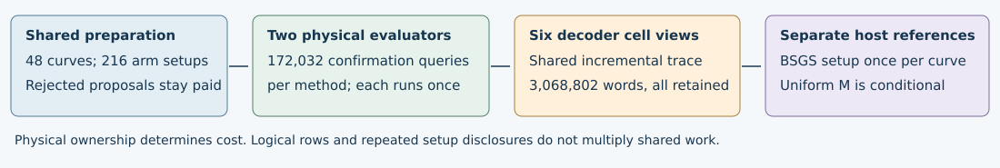

# Fully paid cost accounting — TASK-20261030-f55ebb

**J-cost: inconclusive for a fully paid end-to-end total.** Retained component bookkeeping agrees in every inspected row and exported aggregate. Missing native and full-process dimensions prevent a stronger conclusion. This is an independent deterministic audit of RUN-ECDLP-939237 / EXP-ECDLP-080f41, with zero new scientific trials, inputs, queries or producer calls.

## Observations

The audit streamed all 216 setups, 345,600 single-point records, 36,864 intents, 36,864 physical trace records, 73,728 decoder cells, 73,728 host cells, 48 uniform files and 24 null files. Raw JSONL digests, byte counts and row counts match the completion manifest. All 144 curve/cell aggregates, 72 curve/method vectors, 216 setup disclosures and both export method count/vector records match independent sums. The 5,401,187 primary checks and 14 export/sensitivity checks pass. The original 21 fixed public controls pass; executed source, command output and actual times are retained in checks.json.

There are 1,033,728 physical predicate calls: 345,600 calibration singles + 344,064 calibration trace calls + 172,032 original and 172,032 incremental confirmation calls. Six cells reuse one incremental trace. Intent draw/sampling fields are duplicated in trace records; their physical work is charged once from intents. Shared logical calibration coordinates regenerated by eight arms remain charged on all actual executions.

## Paid worker vectors

Each column has its own unit; columns overlap through nested arithmetic and must never be added. These are source instrumented abstract event counts with algebraic checks, not native replay or machine costs. Common curve certification/proposal integer work and RNG have separate vectors in checks.json.

| Physical component | Group-add calls | Field multiplications | Field inversions |
| --- | ---: | ---: | ---: |
| Base + target coordinate preparation | 32,661 | 118,242 | 27,852 |
| Prepared base/circuit setup | 4,698 | 17,340 | 4,698 |
| Calibration coordinate generation | 7,557,760 | 27,669,624 | 6,447,232 |
| Calibration evaluator + traces | 13,945,167 | 63,125,609 | 13,170,351 |
| Confirmation original | 3,802,570 | 16,998,299 | 3,588,078 |
| Confirmation incremental | 763,850 | 5,268,379 | 709,102 |
| All six physical decoder enumerations | 42,943,594 | 128,447,984 | 38,383,374 |

Curve generation retains 49,155 proposals: 46,596 field rejects, 2,511 order rejects and 48 accepted curves. The target ledger retains 19 duplicate proposals. All generation, base and target sampling vectors are kept separately. A curve is generated once; prepared setup is once per actual curve/arm cache lifetime. Setup cannot be divided away from the batch.

## Decoder outcomes and paid failure work

| Cell | Words | Legal checks | M=0 rows | Success events | Unique targets recovered |
| --- | ---: | ---: | ---: | ---: | ---: |
| t0.e0 | 12,161 | 4,473 | 7,819 | 4 | 4 |
| t0.e2 | 12,415 | 4,568 | 7,735 | 4 | 4 |
| t1.e0 | 182,721 | 67,871 | 133 | 42 | 38 |
| t1.e2 | 185,665 | 68,948 | 6 | 43 | 39 |
| t2.e0 | 1,329,908 | 494,187 | 127 | 214 | 183 |
| t2.e2 | 1,345,932 | 500,234 | 0 | 227 | 196 |

All 3,068,802 word records were inspected. For every legal word both public check invocations, scalar conversion, scalar-bit and group-add counts agree with the retained scalar/check schedule. The 1,140,281 legal words include 452 zero-candidate checks. All 15,820 M=0 cell rows retain paid inversion/cap/list work; they also depend on already-paid trace and preparation work. The smallest witness is decoder-cells.jsonl row 1, confirmation-A-10-0/target0000/rep0/t0.e0: one empty word, M=0, one inverse and the full wrapper work remain recorded.

Both strict methods have 12,288 attempts, 172,032 queries and 1,536 retained targets: 4 recovered, 4,469 rejected, 7,688 empty and 127 undefined attempts. No failure work was omitted. Per-cell cost divided by unique targets recovered is descriptive; component fractions are in checks.json. Repeated successful blindings do not create more unique recovered targets. Zero-success per-curve cells have undefined cost-per-success, not mathematical q=0.

## Host work and matched comparisons

BSGS has 24 setup instances, 1,536 successful online target solves and 2,594 stored table points summed across tables (largest individual table 249 points). The host primitive vector charges setup 3,338 group-add calls once, then online 141,042 calls; these are separate from the higher-level setup/online counters and the full-orbit oracle. Setup disclosed in 64 target rows is not charged 64 times. Cold and warm policies stay separate.

The conditional uniform reference has 73,728 calls, 1,139,829 distinct nonzero guesses and 404 success events; its 21,464,021 host group-add calls exclude candidate M-determination. That work remains paid in the candidate path. Its 15,820 M=0 calls are empty conditional references, not zero-cost candidate attempts. The 24 null files retain 24,552 orientation draws, 198,521,334 SHA-256 blocks and 88,190,784 label lookups. Hash blocks, lookups, group work, stored entries and bytes are distinct dimensions. Calibration mask/evaluator residual vectors are disclosed without inventing component attribution.

An operational solver choosing one method/cell differs from this study, which physically ran both evaluators, all six decoders, calibration and host controls. A cold comparison includes curve/setup/target preparation. Warm reuse states the actual number of shared targets and table memory. Same curve/target distribution, success/stop policy, units/backend, memory and censoring are required. Worker and host field/group definitions are different; no automatic ratio is justified. No P1/3 reference, speedup or exponent is inferred.

## Inference and limitations

The identity S+T+E[C_complete]/q requires iid complete fresh restarts with fixed conditional law, q>0 and finite expected cost. Repeated cells and heterogeneous curves are not iid observations; caps and right censoring retain paid work and do not identify q. No expected restart cost is inferred here.

Native worker counter replay, full host-verifier process cost, RSS and simultaneous full-cache memory, byte representations, interpreter/integer/I/O work, energy/currency and qualified clocks are absent. The maximum retained decoder-cell payload is 184 words / 2618 bits; this is not RSS. Some branches have no retained case. These gaps leave J-cost inconclusive for a fully paid total while the stated retained component identities hold. No scientific status changes.

Evidence: canonical raw directory runs/RUN-ECDLP-939237/modal/collected/raw; host references postrun-from-view-346631; exact paths, row witnesses, full vectors and SHA-256 inventory in checks.json. Decoder raw SHA-256 02c65065c00b46465d01e064584103e30396155d67ea7bb26ff30b132865dc90. No producer or sibling report was used. Original protocol/spec/trial historical embedded metadata exposure is disclosed in the sealed derivation.

Native receipt is preserved: status=invalid_output, checker return code=1, published=false, scientific validity=not_assessed. This audit does not repair or promote that execution status.

## Retained operational component views

These alternative paths charge the chosen online execution plus once-paid prepared setup and blinding RNG. Blinded target multiplication is already in online. The registered primary includes the entire actually executed incremental strict reduction/conversion/check work and the actual t1.e2 decoder; it does not assume a future optimized program. The original evaluator and the other five decoder cells are not added to that path. The study physically executed all streams and all cells.

| Choice | Group-add calls | Field multiplications | Field inversions | Unique recovered | Group calls / unique recovered |
| --- | --- | --- | --- | --- | --- |
| Strict original | 3,803,060 | 17,000,119 | 3,588,568 | 4 | 3,803,060/4 |
| Incremental strict | 764,340 | 5,270,199 | 709,592 | 4 | 764,340/4 |
| Incremental + primary t1.e2 | 3,288,353 | 12,794,145 | 2,957,893 | 39 | 3,288,353/39 |

| Panel | Choice | Success events | Unique recovered | Group calls / unique recovered |
| --- | --- | --- | --- | --- |
| A | Strict original | 4 | 4 | 1,874,180/4 |
| A | Incremental + primary t1.e2 | 25 | 23 | 1,630,656/23 |
| B | Strict original | 0 | 0 | undefined (0) |
| B | Incremental + primary t1.e2 | 18 | 16 | 1,657,697/16 |

All 24 curve vectors, two panel vectors, global vectors and six selected-cell views are retained in checks.json. Zero-hit curves: original 22/24; primary 12/24. Their cost-per-recovered-target values are null. Examples:

| Curve | Original group calls / recovered | Primary group calls / recovered |
| --- | --- | --- |
| confirmation-A-10-0 | undefined (0) | 79,436/4 |
| confirmation-A-10-1 | 100,369/3 | 82,324/8 |
| confirmation-B-16-3 | undefined (0) | undefined (0) |

A separate paid-cohort-reproduction vector additionally charges actual curve certification/generation, base sampling and target-coordinate generation; those remain study input-generation overhead for a solver given public E,G,Q,r. All primitive dimensions and shared-component vectors are preserved. Exact fractions use unique-target denominators, not successful attempt events. This is a descriptive observed component comparison with unmatched recovery behavior and missing native/full-process costs; it is not an expected-cost or runtime advantage.
