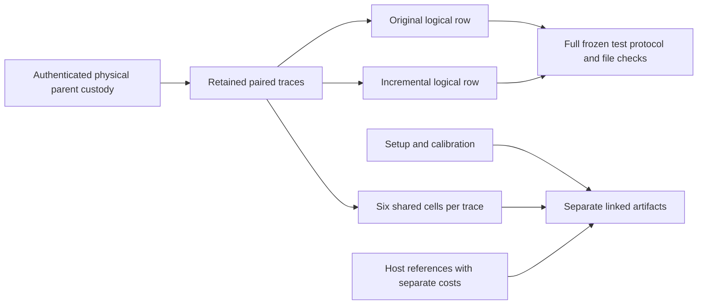

# Independent C3 paired-export source review

TASK-20261029-489ab1 · /root/controlled_export_review · 2026-10-29.

The six assigned joints **hold within the tested source/fixture scope**, with the API and runtime gaps below. This is a per-joint technical review, not approval, readiness synthesis, a scientific or actual-population verdict. Root composes the round. Exact programs, commands, stdin, stdout, stderr, return codes, hashes, findings and correction history are retained in checks.json and its hashed outside support files.

| Exact assigned joint | Observed result | Gap or qualification |
| --- | --- | --- |
| C3-E1 — Complete real protocol and exact two-arm coverage | **holds**. Unchanged complete schema and lint pass on the actual frozen TEST-PAIRED-F11-F23 protocol. Actual `validate` and `check-export --protocol --verify-files` return0/zero findings. A fresh disjoint draft copy is actually frozen and validated, body hash `7f63dd82dd94e16c06aa54169b7472c923c441adaf59bbc9d88ad85f411e2e5e`. A complete one-arm protocol is rejected, as is the historical skeletal TEST-F11 input. | This is a complete test-only protocol, never a future scientific protocol. `filed_before_affected_data=false` is retained; no scientific preregistration claim. Direct exporter seam does not perform production 48-curve host verification. |
| C3-E2 — Actual method counts/recovery/identity | **holds for exporter output and independent raw comparison**. Each method has2 actual paired attempts,11 queries,1 strict recovered event,2 retained unique targets,1 recovered unique target. Every primitive counter matches the separate reviewer sum. Original-only calibration is excluded. Independent affine equations verify retained recovery and failed public checks. Rows derive `RUN-DISCLOSED-ONLY.original/.incremental`, sharing parent, worker, instance and fixed observed nonce. Duplicate row ID, execution cell, different instance and padded row reject at unchanged guards. Raw planned 12288/172032 substitution produces partial/excluded failure rather than those observed counts. | Generic `check-export` does not recompute raw metrics: post-export forged12288/172032 counts pass its shape/file checks but fail the reviewer raw comparison. Direct `make_export` trusts caller-supplied verified status and observation identities; normal `run` supplies them only after lifecycle/authentication/host checks. Synthetic fixture `vm_creates=1` is not an actual VM observation. |
| C3-E3 — Partial/zero/missing arms | **holds**. Missing/empty incremental work emits only the observed original row, failed/excluded; one missing method, shortened query list, missing trace and duplicate trace retain failure/shortfall. Shortened incremental work records 10 queries, not 11 or a planned count. Zero engine starts emit no rows. A failed controller cannot yield succeeded rows. Incomplete observations may have complete export shape while retaining failed/excluded status. | Export shape qualification is not successful execution or scalar recovery. A zero-start outer envelope without a receipt stops earlier at missing bounded regular JSON, retains errors and creates no export or host label artifacts. No missing observation is padded. |
| C3-E4 — Auxiliary/common custody and limits | **holds in assigned source scope**. All12 actual cells remain six per paired trace, separate from method totals. Two setups/common vectors and the third original-only calibration trace remain linked raw data. Analysis charges trace components once and labels decoder component costs separately. Actual no-draw fixed F11 host/reference check verifies BSGS scalar7 and M=0 uniform, with `Stream.below` forbidden. Calibration/references/empty uniform artifacts are separately hashed in exporter outputs; original-only input still has no paired rows and stays unqualified. Synthetic undefined/zero/capped preservation controls remain explicitly incomplete and retain undefined ratios. | Correct paired fixture has no actual undefined/capped cell; those controls are synthetic retention mutants, not newly observed arithmetic. Production reference master entropy, nonzero uniform target draws and 1023 null bank were not run. `wall_valid=false`, `counter_replay_qualified=false`; native RSS/interpreter allocations/I/O/integer internals unmetered. |
| C3-E5 — Prior D1/D2 lifecycle gates | **holds at tested boundaries**. Actual driver seals/checks a complete fixed F11 supervisor envelope with EXP-FIXTURE/RUN-FIXTURE. Corrupt outer archive, missing member, fully resealed wrong independent protocol/source pins and zero-start error envelope reject before guarded verify/reference imports or entropy; all guard counts are 0. Actual source authentication checks5 worker/13 host files, executing host bytes and 8 copied input roles; all eight copied-role mutants reject. | Provider boundary is a retained deterministic F11 tree copy replacing c.run; D2 c.make_plan returns a frozen fixture expected tuple. Ordinary postrun branch uses no injected verifier/fixture law. Renderer suppressed. These exercise real driver/postrun/authentication code, not actual SDK, VM, termination, OS isolation or production sampled workload. |
| C3-E6 — Actual C3/M3 and unchanged source | **holds**. Immutable new inventory helper actually returns0 twice: 4 aliases, 19 preserved sources, full manifest maps. Commit/live/mirror bytes and source→metadata→producer records→snapshot→receipt→binding→release order match. C3 changes exactly two canonical Python files plus mirrors; M3 changes exactly two manifests plus mirrors. R3 has the exact snapshot parent and sole receipt path, with identical live/commit bytes. All 8 snapshot content-map files match; receipt makes the 9th bound path. | C2 inventory/review/snapshot remain historical; old live-C2 gate was not run. Local origin tracking refs contain the actual commits. No network fetch or Git mutation was performed by reviewer. Root merged unrelated main before these probes; reviewed HEAD is `68686a49a3fd137cf90d8b489d609dafeb014d83` and tree checks are clean. |

Independent raw derivation selected the two retained IDs in host-plan.json, then counted nonempty method attempts, query arrays, status/scalar/public-equation records, `(curve_id,target_id)` identities and each counter leaf. It called neither producer observation aggregation nor analysis aggregation for those totals. F11 uses p11,a1,b6,r13,P(2,7),Q(7,2),a5,b1: each method queries 5 times and recovers 7. F23 uses p23,a11,b5,r17,P=Q=(5,22),a1,b1: each queries 6 times and is REJECTED_FINAL_VERIFICATION. F23 decoder cells t1.e0/t1.e2/t2.e0/t2.e2 recover independently of that strict failure; no decoder recovery is attributed to the strict baseline. There are 3 physical trace records including separate F23 calibration,12decoder records, 2 setups, 0 single-point rows. No 12288/172032 observed count is imported from the production plan.

Logical flow.completed=2 means two logical evaluator observations. Both derive from one supplied parent fixture identity, one supplied worker sb-DISCLOSED-ONLY, instance candidate-vm and the fixed 00 nonce. The fixture's engine_execs=1/vm_creates=1 are constructed metadata. No new RUN ledger, independent VM, sampled curve/target or physical population is established. The generic checker also calls failed excluded rows completed by its schema vocabulary; that is not success. Direct preflight-cell positive/duplicate/missing/bad-ID checks separately exercise the unchanged cell identity/coverage guard, first with supplied schema callback and then with actual unchanged cell schema validation. They supply streams/minimal schedule and do not impersonate full verify_bundle production validation.

Actual source C3 is c4d0d3ed9d0732a72559a11871271e195635af88; M3 is a7b60afdf7b15dceb59d38fd301c05f73deef425. Producer records c417f00dff28e811873dbf9e8f44d4b99df4533f, producer release416dea22ea3a0b8accb50c10beef2f379ce5725b, source snapshot0047c968f61c796ca27cd9e0b528cfe9d92f7284, R3b88c661b100d793c43e9099e03beee3567cf2344, binding8de1c30e9d and snapshot release2fda1d318f are actual ancestors checked in order. Candidate math/engine/cohort/sampler/reference/interfaces/host gates/controller/driver/analysis/renderer/schemas/checker remain protected byte-identical. Inventory maps in checks.json preserve exact bytes and hashes rather than inferred future revisions.

Two reviewer harness expectation errors remain visible. Historical skeletal input exits 2 with `REFUSED: document has no recognised schema field`; its initial expected 1 was wrong. The zero-start envelope correctly lacks a controller receipt and refuses at `bounded regular JSON required`; the initial harness expected the later operational-failure message. The entire lifecycle group therefore initially exits 1. Fresh corrected isolated checks capture all four cases and0 host/entropy calls. Neither failure was erased or interpreted as a source defect. The common case recorder's program path identifies the wrapper; checks.json additionally binds each named callable to its actual definition program/hash. Producer/root 42 regressions are history and were not claimed as this reviewer's passes.

The prior completed C2 report was deliberately visible under the published plan; no current-round sibling review or source03 draft was read, and no blind derivation is claimed. Literature/source review used primary internal protocol/export/observation contracts, exact card/plan, unchanged checker/schemas, decoder/control notes and prior C2 report. No external primary paper was retrieved under the no-network card. No literature-completeness, novelty or scientific inference relies on the internal notes. The referenced reviewer.md does not exist; agents/validator.md and agents/red-team.md provide the actual review-plan contract. Actual backend/model/usage/probe/achieved effort are unavailable and null; requested policy review-adversarial/xhigh is not evidence of achieved provenance.

No scientific experiment, candidate population evaluation, benchmark, SDK import/call, VM, network operation, fresh scientific entropy/nonce/cohort/curve/target draw or old-cohort analysis occurred. Fixed F11/F23 records and fixed F11 no-draw known answers are software controls. No DEC decision or new rendering claim is made, so there is no new PDF. Prior render/PDF association and original independence-check errors remain historical and untouched. Source-only diagrams in source-export-b9f48c and the completed C2 report were checked; no scientific graph relation changes here.



The actual independence checker is run after this report exists, against the published plan and this exact read-attestation.yaml. Its command/stdout/stderr/returncode are appended to checks.json. This validates declared ownership/blindness metadata, not the source joint findings or historical rounds.

```json
{
  "review_attestation": {
    "achieved_reasoning_effort": null,
    "actual_sdk_import_or_call": false,
    "blind_derivation_claimed": false,
    "blind_from_respected": null,
    "historical_completed_reports_read": [
      "TASK-20261029-19bc99"
    ],
    "historical_reads_scope": "Published plan deliberately exposes completed C2 report/attestation; no current-round sibling review read.",
    "independent_derivation": "Reviewer loops over retained raw traces with Counter; no call to method_observations or analysis aggregation for per-method derivation. Reviewer affine double/add verifies retained public equations separately. Producer source was visible; this is not blind derivation.",
    "joint_names": {
      "C3-E1": "Complete real protocol and exact two-arm coverage",
      "C3-E2": "Actual method counts/recovery/identity",
      "C3-E3": "Partial/zero/missing arms",
      "C3-E4": "Auxiliary/common custody and limits",
      "C3-E5": "Prior D1/D2 lifecycle gates",
      "C3-E6": "Actual C3/M3 and unchanged source"
    },
    "joints_owned": [
      "C3-E1",
      "C3-E2",
      "C3-E3",
      "C3-E4",
      "C3-E5",
      "C3-E6"
    ],
    "manifest_metadata_commit": "a7b60afdf7b15dceb59d38fd301c05f73deef425",
    "model_probe": null,
    "network_calls": false,
    "new_scientific_nonce_curve_cohort_or_target": false,
    "procedure_deviations": [
      "Two reviewer harness expectation errors retained: skeletal input returns2 for missing schema; zero-start envelope fails at missing receipt before later operational status. Fresh corrected controls recorded.",
      "Renderer is suppressed in full postrun failure controls; no new render/PDF claim. c.run is a retained fixed-tree copy and D2 c.make_plan uses frozen expected fixture tuple. Direct preflight cell seams supply stream/schedule; a later check uses actual unchanged cell schema validator.",
      "No claim of blind derivation: the plan deliberately exposes producer source and completed C2 review."
    ],
    "read_sibling_reports": false,
    "requested_policy": "review-adversarial",
    "requested_reasoning_effort": "xhigh",
    "reviewed_head": "68686a49a3fd137cf90d8b489d609dafeb014d83",
    "role": "reviewer",
    "scientific_runs": 0,
    "serving_backend": null,
    "serving_model": null,
    "session": "/root/controlled_export_review",
    "source_code_commit": "c4d0d3ed9d0732a72559a11871271e195635af88",
    "sources_read": [
      ".claude/skills/research-visuals/SKILL.md",
      ".claude/skills/review-evidence/SKILL.md",
      ".claude/skills/route/SKILL.md",
      "AGENTS.md",
      "agents/red-team.md",
      "agents/validator.md",
      "coordination/goals/GOAL-ECDLP-e70832/batches/BATCH-2fe40f/archives/TASK-20261029-b5a89f/snapshot-receipt.json",
      "coordination/goals/GOAL-ECDLP-e70832/batches/BATCH-2fe40f/claims/TASK-20261029-489ab1.1.claim.json",
      "coordination/goals/GOAL-ECDLP-e70832/batches/BATCH-2fe40f/dispatch_queue.json",
      "coordination/goals/GOAL-ECDLP-e70832/batches/BATCH-2fe40f/export-observation-contract-3f0c21.json",
      "coordination/goals/GOAL-ECDLP-e70832/batches/BATCH-2fe40f/export-preserved-hashes-3f0c21.json",
      "coordination/goals/GOAL-ECDLP-e70832/batches/BATCH-2fe40f/export-review-plan-489ab1.json",
      "coordination/goals/GOAL-ECDLP-e70832/batches/BATCH-2fe40f/exports/TASK-20261029-b9f48c/fixture-checks.json",
      "coordination/goals/GOAL-ECDLP-e70832/batches/BATCH-2fe40f/exports/TASK-20261029-b9f48c/source-inventory.json",
      "coordination/goals/GOAL-ECDLP-e70832/batches/BATCH-2fe40f/exports/TASK-20261029-b9f48c/source/harness/classical_ecdlp_controlled_followup/host-source-manifest.json",
      "coordination/goals/GOAL-ECDLP-e70832/batches/BATCH-2fe40f/exports/TASK-20261029-b9f48c/source/harness/classical_ecdlp_controlled_followup/postrun/run_postrun.py",
      "coordination/goals/GOAL-ECDLP-e70832/batches/BATCH-2fe40f/exports/TASK-20261029-b9f48c/source/harness/classical_ecdlp_controlled_followup/postrun/test_postrun.py",
      "coordination/goals/GOAL-ECDLP-e70832/batches/BATCH-2fe40f/exports/TASK-20261029-b9f48c/source/harness/classical_ecdlp_controlled_followup/worker-source-manifest.json",
      "coordination/goals/GOAL-ECDLP-e70832/batches/BATCH-2fe40f/exports/TASK-20261029-b9f48c/verify_export_inventory.py",
      "coordination/goals/GOAL-ECDLP-e70832/batches/BATCH-2fe40f/reviews/TASK-20261029-19bc99/read-attestation.yaml",
      "coordination/goals/GOAL-ECDLP-e70832/batches/BATCH-2fe40f/reviews/TASK-20261029-19bc99/report.md",
      "docs/agent-contract-extended.md",
      "docs/experiment-protocol.md",
      "docs/lab-contract.md",
      "docs/reports/classical-ecdlp-controlled-followup-20261029/source-export-b9f48c.md",
      "docs/reports/classical-ecdlp-further-leads-20261029/controls/report.md",
      "docs/reports/classical-ecdlp-further-leads-20261029/decoder/report.md",
      "harness/classical_ecdlp_controlled_followup/cohort.py",
      "harness/classical_ecdlp_controlled_followup/constructor.py",
      "harness/classical_ecdlp_controlled_followup/controller.py",
      "harness/classical_ecdlp_controlled_followup/curve.py",
      "harness/classical_ecdlp_controlled_followup/driver.py",
      "harness/classical_ecdlp_controlled_followup/engine-interface.json",
      "harness/classical_ecdlp_controlled_followup/engine.py",
      "harness/classical_ecdlp_controlled_followup/export-delivery-b9f48c.json",
      "harness/classical_ecdlp_controlled_followup/host-source-manifest.json",
      "harness/classical_ecdlp_controlled_followup/host/reference.py",
      "harness/classical_ecdlp_controlled_followup/host/test_verify.py",
      "harness/classical_ecdlp_controlled_followup/host/verifier-interface.json",
      "harness/classical_ecdlp_controlled_followup/host/verify.py",
      "harness/classical_ecdlp_controlled_followup/postrun/analysis.py",
      "harness/classical_ecdlp_controlled_followup/postrun/render_report.py",
      "harness/classical_ecdlp_controlled_followup/postrun/run_postrun.py",
      "harness/classical_ecdlp_controlled_followup/postrun/test_postrun.py",
      "harness/classical_ecdlp_controlled_followup/test_transport.py",
      "harness/classical_ecdlp_controlled_followup/worker-source-manifest.json",
      "harness/classical_ecdlp_controlled_followup/worker_runtime.py",
      "ledger/handoffs/TASK-20261029-489ab1.yaml",
      "schemas/experiment-export.v1.json",
      "schemas/experiment-protocol.v1.json",
      "schemas/experiment-review.v1.json",
      "templates/research-records.md",
      "tools/check_review_independence.py",
      "tools/experiment_protocol.py",
      "/workspace/classical-ecdlp-endpoint-reuse/controlled-followup-20261029/export-repair-final-fixture/checks.json",
      "/workspace/classical-ecdlp-endpoint-reuse/controlled-followup-20261029/export-repair-final-fixture/derived/analysis.json",
      "/workspace/classical-ecdlp-endpoint-reuse/controlled-followup-20261029/export-repair-final-fixture/derived/export.json",
      "/workspace/classical-ecdlp-endpoint-reuse/controlled-followup-20261029/export-repair-final-fixture/paired/collected/host-plan.json",
      "/workspace/classical-ecdlp-endpoint-reuse/controlled-followup-20261029/export-repair-final-fixture/paired/collected/public-cohort.json",
      "/workspace/classical-ecdlp-endpoint-reuse/controlled-followup-20261029/export-repair-final-fixture/paired/collected/raw/decoder-cells.jsonl",
      "/workspace/classical-ecdlp-endpoint-reuse/controlled-followup-20261029/export-repair-final-fixture/paired/collected/raw/setups.jsonl",
      "/workspace/classical-ecdlp-endpoint-reuse/controlled-followup-20261029/export-repair-final-fixture/paired/collected/raw/single-points.jsonl",
      "/workspace/classical-ecdlp-endpoint-reuse/controlled-followup-20261029/export-repair-final-fixture/paired/collected/raw/traces.jsonl",
      "/workspace/classical-ecdlp-endpoint-reuse/controlled-followup-20261029/export-repair-final-fixture/paired/controller-receipt.json",
      "/workspace/classical-ecdlp-endpoint-reuse/controlled-followup-20261029/export-repair-final-fixture/paired/protocol.json",
      "/workspace/classical-ecdlp-endpoint-reuse/controlled-followup-20261029/repair-recheck-work-19bc99/cases/correct-postrun/trial/collected/host-plan.json",
      "/workspace/classical-ecdlp-endpoint-reuse/controlled-followup-20261029/repair-recheck-work-19bc99/cases/correct-postrun/trial/collected/public-cohort.json",
      "/workspace/classical-ecdlp-endpoint-reuse/controlled-followup-20261029/repair-recheck-work-19bc99/cases/correct-postrun/trial/collected/raw/attempt-intents.jsonl",
      "/workspace/classical-ecdlp-endpoint-reuse/controlled-followup-20261029/repair-recheck-work-19bc99/cases/correct-postrun/trial/collected/raw/decoder-cells.jsonl",
      "/workspace/classical-ecdlp-endpoint-reuse/controlled-followup-20261029/repair-recheck-work-19bc99/cases/correct-postrun/trial/collected/raw/engine-completion.json",
      "/workspace/classical-ecdlp-endpoint-reuse/controlled-followup-20261029/repair-recheck-work-19bc99/cases/correct-postrun/trial/collected/raw/engine-summary.json",
      "/workspace/classical-ecdlp-endpoint-reuse/controlled-followup-20261029/repair-recheck-work-19bc99/cases/correct-postrun/trial/collected/raw/setups.jsonl",
      "/workspace/classical-ecdlp-endpoint-reuse/controlled-followup-20261029/repair-recheck-work-19bc99/cases/correct-postrun/trial/collected/raw/single-points.jsonl",
      "/workspace/classical-ecdlp-endpoint-reuse/controlled-followup-20261029/repair-recheck-work-19bc99/cases/correct-postrun/trial/collected/raw/traces.jsonl",
      "/workspace/classical-ecdlp-endpoint-reuse/controlled-followup-20261029/repair-recheck-work-19bc99/cases/correct-postrun/trial/collected/worker.stderr",
      "/workspace/classical-ecdlp-endpoint-reuse/controlled-followup-20261029/repair-recheck-work-19bc99/cases/correct-postrun/trial/collected/worker.stdout",
      "/workspace/classical-ecdlp-endpoint-reuse/controlled-followup-20261029/repair-recheck-work-19bc99/cases/correct-postrun/trial/config.json",
      "/workspace/classical-ecdlp-endpoint-reuse/controlled-followup-20261029/repair-recheck-work-19bc99/cases/correct-postrun/trial/controller-receipt.json",
      "/workspace/classical-ecdlp-endpoint-reuse/controlled-followup-20261029/repair-recheck-work-19bc99/cases/correct-postrun/trial/custody.json",
      "/workspace/classical-ecdlp-endpoint-reuse/controlled-followup-20261029/repair-recheck-work-19bc99/cases/correct-postrun/trial/engine_interface.json",
      "/workspace/classical-ecdlp-endpoint-reuse/controlled-followup-20261029/repair-recheck-work-19bc99/cases/correct-postrun/trial/protocol.json",
      "/workspace/classical-ecdlp-endpoint-reuse/controlled-followup-20261029/export-review-work-489ab1/review_checks.py",
      "/workspace/classical-ecdlp-endpoint-reuse/controlled-followup-20261029/export-review-work-489ab1/review_corrections.py",
      "/workspace/classical-ecdlp-endpoint-reuse/controlled-followup-20261029/export-review-work-489ab1/review_edges.py",
      "/workspace/classical-ecdlp-endpoint-reuse/controlled-followup-20261029/export-review-work-489ab1/review_final_probes.py",
      "skill://plugin_connector_1p_c5b7d5df5d7081918f2c4be5a633ed5d/cloud-environment-runtime/SKILL.md",
      "cloud_environment.environment_status tool result (runtime metadata only)"
    ],
    "task_id": "TASK-20261029-489ab1",
    "usage": null,
    "verdict": {
      "C3-E1": "holds",
      "C3-E2": "holds",
      "C3-E3": "holds",
      "C3-E4": "holds",
      "C3-E5": "holds",
      "C3-E6": "holds"
    },
    "vm_created": false
  }
}
```
