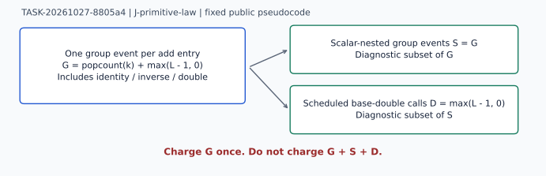

# Blind primitive-law review

TASK-20261027-8805a4 · J-primitive-law · 2026-10-27

**Scoped verdict: holds.** Independent mathematical derivation and a separate affine implementation agree with one group event per explicit add invocation, including identity, inverse and doubling. This is a primitive definition/software check. It does not attest production code, past native execution, native reported counts, runtime or any scientific promotion.

## Observation

The only scientific input was the batch's sanitized `blind-packet/statement.json` plus the preregistered `review-plan.yaml`. Their exact paths and SHA-256 bindings are in `review.json` and `read-attestation.yaml`. No producer implementation, native rows, old ratios, result-bearing Git history or sibling review was read. Repository policy/workflow files were read separately and are listed in the attestation. No external literature or old research was read because the fixed blind handout restricts scientific inputs; no novelty or prior-art claim is made. Affine formulas were derived directly from the stated curve.

Public fixture: E/F383, y² = x³ + 261x + 146; P=(196,297), r=181. Exact arithmetic found discriminant 156 mod383, P on E, jP != O for 1 <= j < 181 and 181P=O. The additional exceptional point (66,0) lies on the same curve but outside 
; it is only a primitive edge case.

`independent_arithmetic.py` uses modular inversion in an affine add routine, one event callback at entry, and the handout's exact right-to-left binary loop. A repeated-add oracle uses a separate function and Fermat inversion. All 513 fixed public integers 0..512 agree in answers, group counts and scheduled double counts. Seven primitive sequences each take one group invocation: O+O, O+P, P+O, P+(-P), P+P, P+(2P), and (66,0)+(66,0). Results include 2P=(359,269), 3P=(141,93). Explicit operation logs are retained for selected scalar cases and every primitive case in `predicted-counts.json`.

## Derivation and comparison

For finite noninverse inputs, the slope is (y2-y1)/(x2-x1), or (3x1²+a)/(2y1) for equal points. The result is (m²-x1-x2, m(x1-x3)-y1), modulo p. Identity and inverse cases return directly. Every branch is still exactly one function invocation; tangent and order-two exceptional handling never create an additional invocation.

For a nonnegative integer k let L=bit_length(k), with L(0)=0, and w=popcount(k). The loop performs w accumulator add invocations and D=max(L-1,0) algorithmic **base-doubling invocations**. Hence G=w+D. This follows from one set-bit test per bit and one base double after every bit except the last; the algorithm neither reduces k modulo r nor shortcuts base O.

| k | w | D | G | kP |
|---:|---:|---:|---:|---|
| 0 | 0 | 0 | 0 | O |
| 1 | 1 | 0 | 1 | (196,297) |
| 2 | 1 | 1 | 2 | (359,269) |
| 3 | 2 | 1 | 3 | (141,93) |
| 180 | 4 | 7 | 11 | (196,86) |
| 181=r | 5 | 7 | 12 | O |
| 182=r+1 | 5 | 7 | 12 | P |
| 331 | 5 | 8 | 13 | (262,200) |
| 362=2r | 5 | 8 | 13 | O |

The same G values hold with base O, checked at k=0,1,r,r+1,2r: all answers are O, but every prescribed add entry counts. Scalar method entries (one even for k=0), scalar-nested group events S=G, and scheduled doubles D are diagnostics, not additional group work. G+S+D would double count or triple count calls. Affine tangent-branch counts are separate: at k=331, D=8 but tangent branches=9 because an accumulator add has equal operands. No unspecified production diagnostic is assumed to have either meaning.

## Control and inference

At k=181, a correct answer O and advertised count12 pass; the same correct answer and advertised count13 fail the count check. A wrong answer P with count12 also fails. Thus a checked scalar witness alone cannot certify a count. No breaking artifact against the specified primitive invocation law was found. The explicit control mutation and event trace are concrete artifacts; the method did not accept the known-false +1 statement.

## Limitation and next action

Only J-primitive-law is assessed. The assertion-count observer and formula inspect this new implementation, not production instrumentation; they cannot establish any reported native counter's execution or coverage. The repeated-add oracle shares the elementary affine definitions and is not a formal proof. Group invocations are not field-operation, memory, CPU or time costs. Negative scalars, reduced-scalar APIs, alternate loops, precomputation and native diagnostics require separate specifications. No new experiment/cohort, native benchmark, performance ratio or private input was used; the handoff's maximum_runs=0 was preserved. The parent clarification added base O and explicit r boundaries without lifting blindness.

The review remains unarchived until the Coordinator's exclusive archive task TASK-20261027-598d0d commits the artifacts. Serving model and model verification are unknown/unverified; requested policy is review-adversarial, effort xhigh. No probe or backend attestation was fabricated. No canonical research graph was inspected or changed: that would exceed the blind read/write scope; the new local diagram only explains this primitive result. The Coordinator may compare the predicted law with other assigned joints, while retaining the production-execution and runtime gaps.
